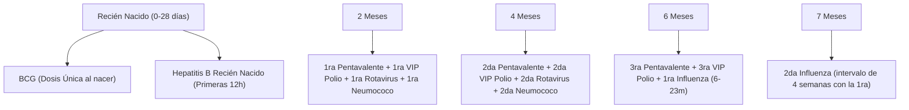

# Motor de Reglas de Vacunación por Edad, Cohorte y Antecedente (PAI Colombia)

> **Estado:** Especificación Técnica de Dominio.  
> **Ubicación en el repositorio:** `docs/domain/motor-reglas-vacunacion-pai.md`.  
> **Marco normativo:** Lineamientos del Programa Ampliado de Inmunizaciones (PAI) del Ministerio de Salud y Protección Social de Colombia.  
> **Módulos impactados:**  
> - Frontend Mobile: `apps/mobile` (`Step3VaccinesStep`, `AttentionController`, filtros de elegibilidad).  
> - Backend API: `services/api` (`com.pai.api.attentions`, `com.pai.api.catalog`, validaciones de admisión).

---

## 1. Objetivo y Principios Rectores

### 1.1 Objetivo del Motor
Evitar que el vacunador visualice un listado plano e indiscriminado de todas las vacunas del catálogo institucional. El sistema debe calcular la edad exacta del paciente (en días, meses y años cumplidos a la fecha de atención) y evaluar sus antecedentes vacunales y condiciones especiales (ej. semanas de gestación, sexo) para **filtrar y priorizar únicamente las vacunas y dosis elegibles para ese paciente**.

### 1.2 Principio 1: No Reiniciar Esquemas
El sistema **nunca debe sugerir ni exigir reiniciar un esquema de vacunación**. Ante esquemas atrasados o interrumpidos:
- Se evalúan las dosis aplicadas registradas en el historial.
- Se habilita la siguiente dosis subsecuente o el refuerzo faltante.
- Se respetan los intervalos mínimos biológicos, sin importar cuánto tiempo haya transcurrido desde la última aplicación.

### 1.3 Principio 2: Vacunación sin Barreras
Garantizar el acceso a la vacunación a cualquier persona residente o en tránsito en el territorio colombiano, independientemente de su estatus migratorio, tipo de aseguramiento o lugar de origen.

---

## 2. Determinación de la Edad y Ventanas de Aplicación

La edad del paciente se calcula con precisión milimétrica restando la fecha de nacimiento (`birthDate`) de la fecha de atención (`attentionDate`):

$$\text{Edad} = \text{attentionDate} - \text{birthDate}$$

El motor clasifica al paciente en los siguientes grupos etarios de control:

| Grupo Etario | Rango en Meses | Rango en Años | Descripción Clínica |
|---|---|---|---|
| **Recién Nacido** | 0 meses (primeras 12-24h) | 0 años | Inmunización neonatal inmediata (BCG y Hep B) |
| **Lactante Menor** | 2 a 11 meses y 29 días | 0 años | Esquema primario pentavalente, polio, rotavirus, neumococo |
| **Primera Infancia** | 12 a 23 meses y 29 días | 1 año | Triple viral, varicela, hepatitis A, fiebre amarilla, 1er refuerzo |
| **Edad Preescolar** | 24 a 59 meses y 29 días | 2 a 4 años | Dosis pendientes, influenza estacional anual |
| **Edad Escolar** | 60 a 107 meses y 29 días | 5 a 8 años | 2dos refuerzos (DPT, Polio), refuerzo varicela |
| **Adolescencia** | 108 a 215 meses y 29 días | 9 a 17 años | VPH (niños y niñas), Td, captación fiebre amarilla |
| **Adulto / MEF** | 10 a 49 años | 10 a 49 años | Mujeres en Edad Fértil (MEF) y población general: Td adulto |
| **Gestante** | Cualquier edad (en gestación) | Gestante | TdaP acelular (sem 26-36 o sem 20), Influenza (sem 14+) |
| **Adulto Mayor** | $\ge 60$ años | $\ge 60$ años | Influenza estacional anual obligatoria |

---

## 3. Matriz Oficial de Reglas por Biológico y Cohorte

### 👶 A. Menores de 1 Año (0 a 11 meses 29 días)



1. **BCG (Antituberculosa):**
   - **Dosis:** Única al nacer (primeras 12 horas).
   - **Regla especial:** Si no se aplicó al nacer, se permite captación tardía hasta los **5 años (59 meses y 29 días)** prioritariamente en población indígena y rural dispersa.
2. **Hepatitis B (Recién Nacido):**
   - **Dosis:** Única neonatal obligatoria en las primeras 12 horas de vida.
3. **Pentavalente (DPT + HB + Hib) & Antipolio Inactivado (VIP / IPV):**
   - **Esquema primario de 3 dosis:**
     - 1ª dosis: A partir de los **2 meses** (60 días).
     - 2ª dosis: A partir de los **4 meses** (120 días).
     - 3ª dosis: A partir de los **6 meses** (180 días).
   - **Intervalo mínimo:** 4 semanas entre dosis primarias.
4. **Rotavirus:**
   - **1ª dosis:** Rango estricto entre los **2 meses (60 días)** y **3 meses con 21 días (111 días)**.
   - **2ª dosis:** Aplicable hasta los **11 meses y 29 días**.
   - **Regla crítica e inviolable:** *Sin primera dosis no hay segunda*. Si el paciente supera los 3 meses y 21 días sin haber recibido la 1ª dosis, la vacuna ya no debe estar disponible por riesgo de invaginación intestinal.
5. **Neumococo Conjugada:**
   - **Esquema primario:** 1ª dosis a los **2 meses**, 2ª dosis a los **4 meses**.
   - **Refuerzo:** A los **12 meses**.
6. **Influenza Estacional (Pediátrica):**
   - **Edad habilitada:** 6 a 23 meses.
   - **Primovacunación:** 2 dosis obligatorias con intervalo de **4 semanas** entre la 1ª y la 2ª.
   - A partir de los 2 años, 1 dosis anual según temporada epidemiológica.

---

### 🧒 B. Primera Infancia y Edad Preescolar (12 meses a 4 años 11 meses 29 días)

1. **Triple Viral (SRP - Sarampión, Rubeola, Paperas):**
   - **1ª dosis:** A los **12 meses**.
   - **1er Refuerzo:** A los **18 meses** (o a los 5 años según la cohorte histórica del lineamiento).
   - **Regla de cohorte:** Se debe garantizar al menos 1 dosis y 1 refuerzo a todos los niños hasta los **10 años 11 meses y 29 días**.
2. **Varicela:**
   - **1ª dosis:** A los **12 meses**.
   - **Regla de cohorte histórica:** Garantizada a toda la cohorte de niños nacidos a partir del **1 de julio de 2014**, incluso si hoy superan los 6 años de edad.
3. **Hepatitis A:**
   - **Dosis:** Única a los **12 meses**.
   - **Regla de cohorte histórica:** Garantizada a toda la cohorte nacida a partir del **1 de enero de 2012**.
4. **Fiebre Amarilla:**
   - **Dosis:** Única a los **18 meses**.
   - **Población susceptible:** Garantizable a toda la población susceptible de **1 a 14 años** (y hasta 59 años en zonas de alto riesgo o viajeros internacionales).
5. **Refuerzos de los 18 Meses:**
   - **1er Refuerzo de Pentavalente** (o DPT según lineamiento local).
   - **1er Refuerzo de Antipolio VIP**.
   - **Refuerzo de Neumococo** (si no fue aplicado a los 12 meses).

---

### 👦 C. Edad Escolar y Adolescencia (5 a 17 años)

1. **A los 5 años (60 meses a 71 meses 29 días):**
   - **2do Refuerzo de DPT** (Difteria, Tétanos, Tos ferina).
   - **2do Refuerzo de Antipolio VIP**.
   - **Refuerzo de Varicela:** Con intervalo mínimo de **3 meses** respecto a la primera dosis.
2. **Virus del Papiloma Humano (VPH):**
   - **Edad habilitada:** **9 a 17 años** cumplidos (tanto para niñas como para niños según actualización nacional).
   - **Esquema general:** Dosis única.
   - **Esquema para personas inmunocomprometidas:** Esquema especial de **2 dosis** (mes 0 y mes 6).
3. **Fiebre Amarilla (Zonas de riesgo y viajeros):**
   - Habilitada para residentes o personas que viajen a municipios de riesgo entre 1 y 59 años.

---

### 👩 D. Adultos, Mujeres en Edad Fértil (MEF) y Gestantes (10 a 60+ años)

1. **Toxoide Tetánico y Diftérico del Adulto (Td):**
   - **Rango de aplicación:** **10 a 49 años** (Mujeres en Edad Fértil y población general en riesgo/accidentes).
   - **Esquema de 5 dosis:**
     - `Td1`: Día 0 (contacto inicial).
     - `Td2`: Al mes de `Td1`.
     - `Td3`: A los 6 meses de `Td2`.
     - `Td4`: Al año de `Td3`.
     - `Td5`: Al año de `Td4`.
   - **Mantenimiento:** Refuerzo cada **10 años** una vez completado el esquema de 5 dosis.
2. **Población Gestante:**
   - **Influenza Estacional:** Dosis única anual a partir de la **semana 14 de gestación**.
   - **TdaP Acelular (dTpa Adulto):** Dosis única **en cada embarazo**, recomendada preferiblemente entre la **semana 26 y 36** de gestación (en población dispersa o indígena habilitada desde la **semana 20**).
3. **Adultos Mayores (60 años y más):**
   - **Influenza Estacional:** Dosis única anual obligatoria.

---

## 4. Arquitectura de Alto Rendimiento: Patrón Specification / Strategy con Despacho $O(1)$

### 4.1 ¿Por qué NO usar condicionales anidados (`if / else` en cascada)?

El uso de condicionales anidados procedimentales presenta graves desventajas de ingeniería de software y rendimiento:

1. **Violación del Principio Open/Closed (OCP - SOLID):** Cada vez que el Ministerio de Salud ajusta un lineamiento (por ejemplo, ampliar VPH o modificar una cohorte), se tendría que alterar una función monolítica con riesgo de introducir efectos colaterales en las demás vacunas.
2. **Complejidad Ciclomática Disparada:** Una función con decenas de ramas anidadas se vuelve propensa a bugs sutiles y resulta extremadamente difícil de someter a pruebas unitarias aisladas.
3. **Desperdicio de Recursos de CPU ($O(N)$ vs $O(1)$):** En cada renderizado o cambio de fecha, evaluar secuencialmente 20 o 30 bloques de `if-else` genera comparaciones redundantes.

### 4.2 Solución Arquitectural: Specification + Hash Dispatcher

En su lugar, se implementa una arquitectura basada en los patrones **Specification** y **Strategy**, complementada con un diccionario de despacho en tiempo constante $O(1)$ y objetos de contexto inmutables (estilo Flyweight):

```mermaid
classDiagram
    class PatientEligibilityContext {
        +int ageInDays
        +int ageInMonths
        +int ageInYears
        +DateTime? birthDate
        +DateTime? attentionDate
        +String? sex
        +bool isPregnant
        +int? gestationalWeeks
        +bool hasSpecialCondition
        +Set~String~ appliedDoseKeys
        +String formattedAgeSummary
        +fromDates() PatientEligibilityContext
    }

    class VaccineEligibilityRule {
        <<interface>>
        +isEligible(PatientEligibilityContext ctx) bool
    }

    class BcgRule { +isEligible(ctx) }
    class HepatitisBRecienNacidoRule { +isEligible(ctx) }
    class PolioRule { +isEligible(ctx) }
    class PentavalenteRule { +isEligible(ctx) }
    class RotavirusRule { +isEligible(ctx) }
    class NeumococoRule { +isEligible(ctx) }
    class TripleViralRule { +isEligible(ctx) }
    class VaricelaRule { +isEligible(ctx) }
    class HepatitisAPediatricaRule { +isEligible(ctx) }
    class FiebreAmarillaRule { +isEligible(ctx) }
    class DptRule { +isEligible(ctx) }
    class VphRule { +isEligible(ctx) }
    class TdAdultoRule { +isEligible(ctx) }
    class DtpaAdultoRule { +isEligible(ctx) }
    class InfluenzaRule { +isEligible(ctx) }

    VaccineEligibilityRule <|.. BcgRule
    VaccineEligibilityRule <|.. HepatitisBRecienNacidoRule
    VaccineEligibilityRule <|.. PolioRule
    VaccineEligibilityRule <|.. PentavalenteRule
    VaccineEligibilityRule <|.. RotavirusRule
    VaccineEligibilityRule <|.. NeumococoRule
    VaccineEligibilityRule <|.. TripleViralRule
    VaccineEligibilityRule <|.. VaricelaRule
    VaccineEligibilityRule <|.. HepatitisAPediatricaRule
    VaccineEligibilityRule <|.. FiebreAmarillaRule
    VaccineEligibilityRule <|.. DptRule
    VaccineEligibilityRule <|.. VphRule
    VaccineEligibilityRule <|.. TdAdultoRule
    VaccineEligibilityRule <|.. DtpaAdultoRule
    VaccineEligibilityRule <|.. InfluenzaRule

    class VaccineEligibilityEngine {
        -Map~String, VaccineEligibilityRule~ _rulesByCode
        +isEligible(EffectiveVaccine vaccine, PatientEligibilityContext ctx) bool
        +isDoseEligible(EffectiveVaccine vaccine, EffectiveOption dose, PatientEligibilityContext ctx) bool
        +getDoseIneligibilityWarning(EffectiveVaccine vaccine, EffectiveOption dose, PatientEligibilityContext ctx) String?
    }

    VaccineEligibilityEngine o-- VaccineEligibilityRule
```



### 4.3 Implementación de Alto Rendimiento en Dart (`apps/mobile`)

El motor se encuentra implementado en `apps/mobile/lib/features/attentions/domain/services/vaccine_eligibility_engine.dart`:

```dart
/// Contexto inmutable con los datos del paciente necesarios para evaluar
/// la elegibilidad de vacunas y dosis según el esquema oficial PAI Colombia.
class PatientEligibilityContext {
  const PatientEligibilityContext({
    required this.ageInDays,
    required this.ageInMonths,
    required this.ageInYears,
    this.birthDate,
    this.attentionDate,
    this.sex,
    this.isPregnant = false,
    this.gestationalWeeks,
    this.hasSpecialCondition = false,
    this.appliedDoseKeys = const {},
  });

  final int ageInDays;
  final int ageInMonths;
  final int ageInYears;
  final DateTime? birthDate;
  final DateTime? attentionDate;
  final String? sex;
  final bool isPregnant;
  final int? gestationalWeeks;
  final bool hasSpecialCondition;
  final Set<String> appliedDoseKeys; // Lookup O(1) de dosis previas

  factory PatientEligibilityContext.fromDates({
    required DateTime? birthDate,
    required DateTime attentionDate,
    String? sex,
    String? userCondition,
    int? gestationalWeeks,
    bool hasSpecialCondition = false,
    Set<String> appliedDoseKeys = const {},
  }) { ... }
}

/// Contrato del Patrón Specification: cada biológico implementa su regla
/// de forma aislada e inmutable (Flyweight).
abstract interface class VaccineEligibilityRule {
  bool isEligible(PatientEligibilityContext ctx);
}

// ==========================================
// Reglas encapsuladas e inmutables (Flyweight)
// ==========================================

class BcgRule implements VaccineEligibilityRule {
  const BcgRule();
  @override
  bool isEligible(PatientEligibilityContext ctx) {
    if (ctx.ageInDays <= 30) return true;
    if (ctx.hasSpecialCondition && ctx.ageInMonths < 60) return true;
    return false;
  }
}

class RotavirusRule implements VaccineEligibilityRule {
  const RotavirusRule();
  @override
  bool isEligible(PatientEligibilityContext ctx) {
    final hasDose1 = ctx.appliedDoseKeys.any((k) =>
        k.toLowerCase().contains('rotavirus') &&
        (k.contains('1') || k.contains('primera')));
    if (!hasDose1) {
      // 1ra dosis estricta: entre 60 y 111 días (3 meses y 21 días)
      return ctx.ageInDays >= 60 && ctx.ageInDays <= 111;
    }
    // 2da dosis: hasta los 11 meses y 29 días
    return ctx.ageInMonths < 12;
  }
}

class VphRule implements VaccineEligibilityRule {
  const VphRule();
  @override
  bool isEligible(PatientEligibilityContext ctx) =>
      ctx.ageInYears >= 9 && ctx.ageInYears <= 17;
}

class TdAdultoRule implements VaccineEligibilityRule {
  const TdAdultoRule();
  @override
  bool isEligible(PatientEligibilityContext ctx) =>
      ctx.ageInYears >= 10 && ctx.ageInYears <= 49;
}

class DtpaAdultoRule implements VaccineEligibilityRule {
  const DtpaAdultoRule();
  @override
  bool isEligible(PatientEligibilityContext ctx) {
    if (!ctx.isPregnant) return false;
    final weeks = ctx.gestationalWeeks ?? 0;
    return weeks >= 20;
  }
}

// ==========================================
// Registro y Despacho O(1) (Hash Table)
// ==========================================

class VaccineEligibilityEngine {
  VaccineEligibilityEngine._();

  static const Map<String, VaccineEligibilityRule> _rulesByCode = {
    'bcg': BcgRule(),
    'hepatitis_b': HepatitisBRecienNacidoRule(),
    'polio_ipv': PolioRule(),
    'polio_oral': PolioRule(),
    'pentavalente': PentavalenteRule(),
    'hexavalente': PentavalenteRule(),
    'rotavirus': RotavirusRule(),
    'neumococo': NeumococoRule(),
    'srp': TripleViralRule(),
    'varicela': VaricelaRule(),
    'hepatitis_a_pediatrica': HepatitisAPediatricaRule(),
    'fiebre_amarilla': FiebreAmarillaRule(),
    'dpt': DptRule(),
    'dtpa_pediatrico': DptRule(),
    'td_pediatrico': DptRule(),
    'vph': VphRule(),
    'td_adulto': TdAdultoRule(),
    'dtpa_adulto': DtpaAdultoRule(),
    'influenza': InfluenzaRule(),
  };

  /// Evalúa la elegibilidad en tiempo O(1) por biológico sin condicionales anidados.
  static bool isEligible(EffectiveVaccine vaccine, PatientEligibilityContext ctx) {
    final code = vaccine.code.toLowerCase().trim();
    final rule = _rulesByCode[code];
    return rule != null ? rule.isEligible(ctx) : true;
  }
}
```

### 4.4 Ventajas de Rendimiento y Memoria
1. **Acceso $O(1)$:** Despacho instantáneo mediante diccionario hash (`_rulesByCode`), eliminando completamente la cascada de condicionales anidados (`if-else`).
2. **Cero Garbage Collection:** Todas las reglas son instancias `const` inmutables (patrón Flyweight), asignadas en tiempo de compilación. No generan recolección de basura durante los ciclos de build de Flutter.
3. **Contexto Precalculado:** `PatientEligibilityContext.fromDates()` se ejecuta una sola vez al cargar o cambiar la fecha, evitando recalcular diferencias de fechas en cada iteración de la lista de vacunas.
4. **Testabilidad Aislada:** Cada biológico cuenta con su propia clase de especificación que se verifica de forma unitaria con independencia del resto del catálogo.

---

## 5. Estrategia de UX en la Interfaz Móvil

Para que el personal de enfermería y vacunación trabaje de forma rápida y sin tropiezos:

1. **Filtro Inteligente por Defecto ("Sugeridas por Edad"):**
   - Al entrar al **Paso 3 (Vacunas y Dosis)** de `NuevaAtencionPage`, el listado solo muestra las vacunas que cumplen con las reglas del PAI para la edad exacta del paciente.
   - Se muestra un banner informativo con el resumen de edad calculada (ej. `2 años` o `4 meses`).
2. **Switch de Contingencia Operativa ("Mostrar todas las vacunas"):**
   - Se provee un botón interactivo `[ Mostrar todas las vacunas ]` / `[ Mostrar solo sugeridas ]` en la cabecera del Paso 3.
   - Si un vacunador atiende un caso clínico especial (captación extramural tardía, paciente extranjero sin esquema previo, indicación médica particular), puede habilitar este switch para acceder a cualquier biológico del catálogo institucional sin bloquear la atención.
3. **Validación Estricta de Dosis Prerrequisito:**
   - Para biológicos con reglas biológicas críticas (ej. Rotavirus), el motor valida que no se seleccione una segunda dosis si no existe antecedente registrado de primera dosis, emitiendo una alerta explicativa inmediata.

---

## 6. Estado de la Implementación y Pruebas Unitarias

- [x] **Servicio de Reglas (`VaccineEligibilityEngine`):**
  - Implementado en `apps/mobile/lib/features/attentions/domain/services/vaccine_eligibility_engine.dart`.
  - Despacho $O(1)$ por mapa de reglas `const` sin ramas de `if/else` anidadas.
- [x] **Suite de Pruebas Unitarias (10/10 pasando):**
  - Ubicación: `apps/mobile/test/features/attentions/vaccine_eligibility_engine_test.dart`.
  - Casos verificados:
    1. Recién nacido (0 días): BCG y Hepatitis B neonatal elegibles; Rotavirus inelegible.
    2. Lactante 2 meses (60 días): Pentavalente, Polio, Neumococo, Rotavirus 1ra dosis elegibles; BCG rutinario inelegible.
    3. Rotavirus frontera estricta: 3 meses y 20 días (110 días) elegible; 3 meses y 22 días (112 días) inelegible.
    4. Rotavirus 2da dosis: bloqueada sin antecedente de 1ra dosis; habilitada con antecedente.
    5. Primera infancia (12 meses): Triple Viral, Varicela, Hepatitis A elegibles.
    6. Varicela cohorte histórica: excluida para nacidos antes del 1 de julio de 2014.
    7. Escolar 5 años: Refuerzos DPT, Polio, Varicela elegibles; Rotavirus inelegible.
    8. Adolescencia 10 años: VPH y Td Adulto elegibles; Pentavalente infantil inelegible.
    9. Gestante (sem 26): TdaP acelular e Influenza gestacional elegibles.
    10. Adulto mayor (65 años): Influenza estacional elegible.
- [x] **Integración en UI Móvil:**
  - `Step3VaccinesStep`: Filtro reactivo automático con soporte de toggle contingente ("Mostrar todas las vacunas").
  - `NuevaAtencionPage`: Preserva el estado de filtrado por biológico y reactividad fluida de 60/120 fps.
