# Guia de estudio — Patrones estructurales (GoF) en Tu Vacuna PAI

Guia para **estudiar, exponer y compartir** los 3 patrones estructurales del GoF tal como se aplican en el backend (`services/api`, Spring Boot 3, Java 21). Resume y enlaza a los docs detallados de cada patron en `docs/patterns-design/`.

---

## 0. Como usar esta guia

- Cada patron tiene la misma plantilla: **que es → donde esta → evidencia de codigo (antes vs. despues) → como nos ayuda → pros/contras → guion oral (30 s) → preguntas del profesor**.
- Los **guiones orales** estan redactados listos para exponer.
- Al final se incluye el **diagrama de clases UML consolidado (Mermaid)** y el comando de verificacion de pruebas.

---

## 1. Que son los patrones estructurales

Los **patrones estructurales** se ocupan de como se **componen y relacionan las clases y objetos** para formar estructuras mas grandes y flexibles, manteniendo los sistemas desacoplados y faciles de mantener:

1. **Proxy (Protection Proxy)** — Controla el acceso a un objeto intermediando y validando permisos de seguridad antes de delegar en el objeto real.
2. **Decorator (Decorador)** — Anade responsabilidades dinamicas (como sanitizacion y enmascaramiento de datos) envolviendo al objeto original sin modificar su codigo ni alterar su interfaz.
3. **Adapter (Adaptador)** — Convierte la interfaz tecnica o protocolo de una libreria/servicio externo (como las Edge Functions de Supabase) a la interfaz de dominio que espera la aplicacion.

---

## 2. Tabla resumen (Control de Cambios PE-01 a PE-03)

| ID | Patron | Ubicacion en el Codigo | Problema Previo | Mejora Obtenida |
|---|---|---|---|---|
| **PE-01** | **Proxy** | `catalog/service/VaccineSecurityProxy.java`<br>`catalog/service/VaccineService.java`<br>`catalog/service/DefaultVaccineService.java` | `VaccineService` mezclaba la logica de negocio con verificaciones imperativas de seguridad (`PermissionGuard`), forzando consultas a BD innecesarias y violando SRP. | Se intercepta el acceso a nivel de interfaz: si el actor no tiene permisos, se cortocircuita la ejecucion antes de tocar la base de datos o el servicio real. |
| **PE-02** | **Decorator** | `audit/service/AuditRecorderDecorator.java`<br>`audit/service/MaskingAuditRecorderDecorator.java`<br>`audit/service/AuditService.java` | `AuditService` persistia eventos directamente en BD. Sanitizar contrasenas o tokens sensibles en el JSON exigia modificar y contaminar la persistencia (viola OCP y SRP). | Se desacopla la persistencia del preprocesamiento. `MaskingAuditRecorderDecorator` intercepta y enmascara campos sensibles (`password`, `token`) de forma transparente antes de persistir; extensible a nuevos decoradores. |
| **PE-03** | **Adapter** | `identity/service/SupabaseAuthAdapter.java`<br>`identity/service/SupabaseAuthRestClient.java`<br>`identity/service/AuthUserProvisioningClient.java` | `SupabaseAuthUserClient` implementaba directamente el puerto de dominio mezclando el protocolo HTTP de bajo nivel de Supabase Edge Functions con la logica de negocio y excepciones del dominio. | Se separa el cliente HTTP de bajo nivel (`SupabaseAuthRestClient`, Adaptee) del adaptador de dominio (`SupabaseAuthAdapter`, Adapter). El adaptador traduce datos y excepciones HTTP a excepciones de dominio. |

---

## 3. Proxy (Protection Proxy)

### 3.1 Que es
Proporcionar un sustituto o intermediario de otro objeto para controlar el acceso al mismo. En TU-VACUNA-PAI se implementa como **Protection Proxy** para autorizacion previa al acceso a datos.

### 3.2 Donde esta
- **Subject:** `com.pai.api.catalog.service.VaccineService` (interface)
- **RealSubject:** `com.pai.api.catalog.service.DefaultVaccineService`
- **Proxy:** `com.pai.api.catalog.service.VaccineSecurityProxy` (`@Primary`)
- **Collaborator:** `com.pai.api.shared.security.PermissionGuard`
- **Doc detallado:** `docs/patterns-design/proxy/README.md`

### 3.3 Guion oral (30 s)
> *"Para proteger el catalogo de vacunas no metemos ifs de permisos dentro del servicio de base de datos ni en cada endpoint. Usamos un Protection Proxy llamado `VaccineSecurityProxy`. Implementa la misma interfaz `VaccineService`, intercepta la llamada, valida los permisos con `PermissionGuard` y si el usuario no tiene autorizacion, corta la ejecucion de inmediato sin tocar la base de datos."*

---

## 4. Decorator (Decorador)

### 4.1 Que es
Anadir responsabilidades a un objeto dinamicamente envolviendolo con otro objeto de su misma interfaz.

### 4.2 Donde esta
- **Component:** `com.pai.api.audit.service.AuditRecorder` (interface)
- **ConcreteComponent:** `com.pai.api.audit.service.AuditService` (`@Service("auditService")`)
- **Decorator:** `com.pai.api.audit.service.AuditRecorderDecorator` (abstract)
- **ConcreteDecorator:** `com.pai.api.audit.service.MaskingAuditRecorderDecorator` (`@Primary`)
- **Doc detallado:** `docs/patterns-design/decorator/README.md`

### 4.3 Como nos ayuda (Antes vs. Despues)
- **Antes:** `AuditService` guardaba directamente el payload en la base de datos PostgreSQL. Si una accion contenia contrasenas o tokens, se guardaban en claro. Modificar el metodo violaba OCP.
- **Despues:** `MaskingAuditRecorderDecorator` intercepta el `AuditRecord`, detecta llaves sensibles (`password`, `token`, `secret`) y las reemplaza por `******` en mapas anidados antes de pasar el registro al `AuditService` que realiza la persistencia JPA.

### 4.4 Guion oral (30 s)
> *"En salud y auditoria clinica no podemos almacenar contrasenas o tokens en claro en las tablas de auditoria. En lugar de ensuciar el servicio de persistencia JPA, aplicamos el patron Decorator. Creamos `MaskingAuditRecorderDecorator` que envuelve a `AuditService`. Sanitiza llaves sensibles en el JSON antes de persistir, permitiendo agregar mas decoradores (como metricas o colas asincronas) sin tocar una sola linea de codigo existente."*

---

## 5. Adapter (Adaptador)

### 5.1 Que es
Adaptar la interfaz de una clase o protocolo incompatible a la interfaz que espera el dominio de la aplicacion.

### 5.2 Donde esta
- **Target:** `com.pai.api.identity.service.AuthUserProvisioningClient` (interface)
- **Adaptee:** `com.pai.api.identity.service.SupabaseAuthRestClient`
- **Adapter:** `com.pai.api.identity.service.SupabaseAuthAdapter` (`@Primary`)
- **Client:** `com.pai.api.identity.service.UserProvisioningService`
- **Doc detallado:** `docs/patterns-design/adapter/README.md`

### 5.3 Como nos ayuda (Antes vs. Despues)
- **Antes:** `SupabaseAuthUserClient` mezclaba construccion de requests HTTP con `RestClient`, URLs de bajo nivel y manejo de excepciones de red directamente dentro del contrato del dominio.
- **Despues:** Se divide en dos piezas limpias: `SupabaseAuthRestClient` (Adaptee) maneja exclusivamente las llamadas HTTP a Supabase; `SupabaseAuthAdapter` (Adapter) implementa `AuthUserProvisioningClient` y traduce los DTOs del dominio y convierte codigos de error HTTP (409 Conflict, 500) en excepciones semanticas (`EmailAlreadyExistsException`, `UncertainProvisioningException`).

### 5.4 Guion oral (30 s)
> *"Para el aprovisionamiento de usuarios en Supabase Auth aplicamos el patron Adapter. Nuestro servicio de negocio solo conoce la interfaz `AuthUserProvisioningClient`. El `SupabaseAuthAdapter` toma esa llamada, la adapta al cliente HTTP de bajo nivel `SupabaseAuthRestClient`, y traduce las respuestas y errores HTTP a excepciones de nuestro propio dominio. Si manana cambiamos Supabase por Keycloak o Auth0, solo creamos un nuevo Adapter sin tocar la logica de negocio."*

---

## 6. Diagrama de Clases UML Consolidado (Mermaid)

```mermaid
classDiagram
    direction TB

    namespace Catalog_Proxy {
        class VaccineService {
            <<interface (Subject)>>
            +list(actor: UUID) List
            +create(actor: UUID, r: VaccineRequest) VaccineResponse
        }
        class VaccineSecurityProxy {
            <<Proxy (PE-01)>>
            -realService: VaccineService
            -guard: PermissionGuard
        }
        class DefaultVaccineService {
            <<RealSubject>>
            -vaccines: VaccineRepository
        }
    }

    namespace Audit_Decorator {
        class AuditRecorder {
            <<interface (Component)>>
            +record(record: AuditRecord) void
        }
        class AuditRecorderDecorator {
            <<abstract (Decorator PE-02)>>
            #delegate: AuditRecorder
            +record(record: AuditRecord) void
        }
        class MaskingAuditRecorderDecorator {
            <<ConcreteDecorator (@Primary)>>
            +record(record: AuditRecord) void
            -maskSensitiveData(record: AuditRecord) AuditRecord
        }
        class AuditService {
            <<ConcreteComponent>>
            -repository: AuditEventRepository
            +record(record: AuditRecord) void
        }
    }

    namespace Identity_Adapter {
        class AuthUserProvisioningClient {
            <<interface (Target)>>
            +createAuthUser(token, opId, email, pass, name, profile) UUID
            +deleteAuthUser(token, userId) void
        }
        class SupabaseAuthAdapter {
            <<Adapter (PE-03)>>
            -restClient: SupabaseAuthRestClient
            +createAuthUser(...) UUID
        }
        class SupabaseAuthRestClient {
            <<Adaptee>>
            -restClient: RestClient
            -baseUrl: String
            +postCreateAuthUser(token, payload) ResponseEntity
        }
    }

    %% Conexiones Proxy
    VaccineSecurityProxy ..|> VaccineService
    DefaultVaccineService ..|> VaccineService
    VaccineSecurityProxy --> DefaultVaccineService : delega si autorizado

    %% Conexiones Decorator
    AuditService ..|> AuditRecorder
    AuditRecorderDecorator ..|> AuditRecorder
    AuditRecorderDecorator o--> AuditRecorder : contiene delegate
    MaskingAuditRecorderDecorator --|> AuditRecorderDecorator
    MaskingAuditRecorderDecorator --> AuditService : inyecta via @Qualifier

    %% Conexiones Adapter
    SupabaseAuthAdapter ..|> AuthUserProvisioningClient
    SupabaseAuthAdapter --> SupabaseAuthRestClient : adapta y delega
```



---

## 7. Verificacion con Maven

Para ejecutar todas las pruebas unitarias y las reglas de arquitectura de ArchUnit:

```bash
cd services/api
./mvnw test
```

Resultado esperado:
```
[INFO] Results:
[INFO] Tests run: 257, Failures: 0, Errors: 0, Skipped: 0
[INFO] BUILD SUCCESS
```
