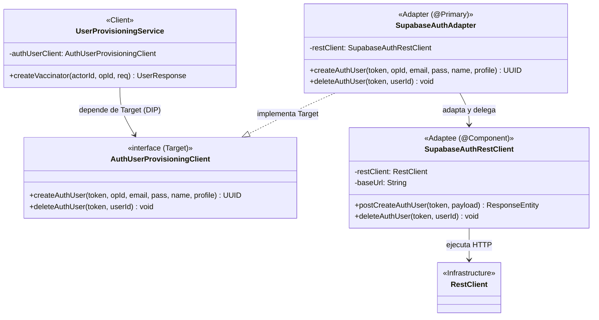

# Patron Estructural: Adapter (Adaptador)

## 1. Intencion

Convertir la interfaz de una clase en otra interfaz que los clientes esperan. El patron **Adapter** permite que clases con interfaces incompatibles trabajen juntas. En este caso particular, se implementa sobre el aprovisionamiento de identidades de Supabase Auth (`AuthUserProvisioningClient`).

El adaptador desacopla la logica de negocio de la aplicacion (`UserProvisioningService`) de los detalles tecnicos y de red de las Edge Functions de Supabase (`SupabaseAuthRestClient`), traduciendo objetos del dominio clinico (`AuthUserProfile`, `UUID operationId`) al formato de peticion HTTP requerido, y adaptando las excepciones de transporte de red a excepciones tipadas de negocio.

---

## 2. Ubicacion en el Backend

- **`Target` (Interfaz esperada por el dominio):**  
  `services/api/src/main/java/com/pai/api/identity/service/AuthUserProvisioningClient.java`
- **`Adaptee` (Componente tecnico de transporte HTTP con Supabase):**  
  `services/api/src/main/java/com/pai/api/identity/service/SupabaseAuthRestClient.java`
- **`Adapter` (Adaptador de dominio con `@Primary`):**  
  `services/api/src/main/java/com/pai/api/identity/service/SupabaseAuthAdapter.java`
- **`Client` (Consumidor del dominio):**  
  `services/api/src/main/java/com/pai/api/identity/service/UserProvisioningService.java`
- **`Legacy / Deprecated`:**  
  `services/api/src/main/java/com/pai/api/identity/service/SupabaseAuthUserClient.java`
- **Pruebas unitarias del Adapter:**  
  `services/api/src/test/java/com/pai/api/identity/service/SupabaseAuthAdapterTest.java`

---

## 3. Matriz de Roles del Patron (GoF)

| Rol GoF | Componente en TU-VACUNA-PAI | Responsabilidad |
| :--- | :--- | :--- |
| **`Target`** | `AuthUserProvisioningClient` *(interface)* | Define el contrato abstracto que `UserProvisioningService` requiere para crear o eliminar identidades. |
| **`Adaptee`** | `SupabaseAuthRestClient` | Maneja la comunicacion HTTP de bajo nivel (`RestClient`), headers `Authorization: Bearer` y endpoints de Supabase. |
| **`Adapter`** | `SupabaseAuthAdapter` | Implementa `AuthUserProvisioningClient`, traduce objetos y adapta excepciones HTTP a excepciones de dominio. |
| **`Client`** | `UserProvisioningService` | Orquesta el aprovisionamiento (auth + app users) dependiendo solo de la abstraccion del Target. |

---

## 4. Codigo del ANTES (Sin Patron Adapter)

Antes de aplicar el patron, la clase `SupabaseAuthUserClient` implementaba directamente la interfaz del Target pero mezclaba en un solo archivo la construccion de peticiones HTTP, el parsing de mapas crudos y el manejo de excepciones de red.

### 4.1. `services/api/src/main/java/com/pai/api/identity/service/SupabaseAuthUserClient.java` (Antes)
```java
package com.pai.api.identity.service;

import com.pai.api.identity.exception.*;
import java.util.*;
import org.springframework.beans.factory.annotation.Value;
import org.springframework.http.HttpStatus;
import org.springframework.stereotype.Component;
import org.springframework.web.client.*;

@Component
public class SupabaseAuthUserClient implements AuthUserProvisioningClient {

  private final RestClient restClient;
  private final String baseUrl;

  public SupabaseAuthUserClient(
      @Value("${app.auth-functions-url}") String baseUrl, RestClient.Builder restClientBuilder) {
    this.baseUrl = baseUrl;
    this.restClient = restClientBuilder.build();
  }

  @Override
  public UUID createAuthUser(
      String accessToken, UUID operationId, String email, String password,
      String fullName, AuthUserProfile profile) {
    // LIMITACION: Mezcla de transporte HTTP de bajo nivel con el contrato de dominio.
    Map<String, Object> body = new HashMap<>();
    body.put("email", email);
    body.put("password", password);
    body.put("fullName", fullName);
    body.put("operationId", operationId);
    if (profile != null) {
      putIfPresent(body, "documentType", profile.documentType());
      putIfPresent(body, "documentNumber", profile.documentNumber());
      putIfPresent(body, "phone", profile.phone());
      putIfPresent(body, "birthDate", profile.birthDate() == null ? null : profile.birthDate().toString());
      putIfPresent(body, "gender", profile.gender());
      putIfPresent(body, "professionCode", profile.professionCode());
      putIfPresent(body, "professionalRegistrationNumber", profile.professionalRegistrationNumber());
      putIfPresent(body, "professionalRegistrationType", profile.professionalRegistrationType());
    }

    try {
      var response = restClient.post()
          .uri(baseUrl + "/create-auth-user")
          .header("Authorization", "Bearer " + accessToken)
          .body(body)
          .retrieve()
          .onStatus(status -> status == HttpStatus.CONFLICT, (req, res) -> {
            throw new EmailAlreadyExistsException("Ya existe un usuario con ese correo.");
          })
          .toEntity(Map.class);

      Object rawId = response.getBody() == null ? null : response.getBody().get("id");
      if (rawId == null) throw new UncertainProvisioningException("La Edge Function no devolvio el id.");
      return UUID.fromString(rawId.toString());
    } catch (HttpStatusCodeException ex) {
      if (ex.getStatusCode().is5xxServerError()) {
        throw new UncertainProvisioningException("No se pudo confirmar la creacion del usuario.", ex);
      }
      throw new AuthUserProvisioningException("El servicio de identidad rechazo la creacion del usuario.", ex);
    } catch (ResourceAccessException ex) {
      throw new UncertainProvisioningException("Sin respuesta del servicio de identidad.", ex);
    }
  }

  @Override
  public void deleteAuthUser(String accessToken, UUID userId) {
    restClient.delete()
        .uri(baseUrl + "/delete-auth-user/{id}", userId)
        .header("Authorization", "Bearer " + accessToken)
        .retrieve()
        .toBodilessEntity();
  }
}
```

---

## 5. Codigo del DESPUES (Con Patron Adapter)

### 5.1. Adaptee Tecnico: `SupabaseAuthRestClient.java`
```java
package com.pai.api.identity.service;

import java.util.Map;
import java.util.UUID;
import org.springframework.beans.factory.annotation.Value;
import org.springframework.http.ResponseEntity;
import org.springframework.stereotype.Component;
import org.springframework.web.client.RestClient;

@Component
public class SupabaseAuthRestClient {

  private final RestClient restClient;
  private final String baseUrl;

  public SupabaseAuthRestClient(
      @Value("${app.auth-functions-url}") String baseUrl, RestClient.Builder restClientBuilder) {
    this.baseUrl = baseUrl;
    this.restClient = restClientBuilder.build();
  }

  public ResponseEntity<Map> postCreateAuthUser(String accessToken, Map<String, Object> payload) {
    return restClient.post()
        .uri(baseUrl + "/create-auth-user")
        .header("Authorization", "Bearer " + accessToken)
        .body(payload)
        .retrieve()
        .toEntity(Map.class);
  }

  public void deleteAuthUser(String accessToken, UUID userId) {
    restClient.delete()
        .uri(baseUrl + "/delete-auth-user/{id}", userId)
        .header("Authorization", "Bearer " + accessToken)
        .retrieve()
        .toBodilessEntity();
  }
}
```

### 5.2. Adapter de Dominio: `SupabaseAuthAdapter.java`
```java
package com.pai.api.identity.service;

import com.pai.api.identity.exception.AuthUserProvisioningException;
import com.pai.api.identity.exception.EmailAlreadyExistsException;
import com.pai.api.identity.exception.UncertainProvisioningException;
import java.util.HashMap;
import java.util.Map;
import java.util.UUID;
import org.springframework.context.annotation.Primary;
import org.springframework.http.HttpStatus;
import org.springframework.stereotype.Component;
import org.springframework.web.client.HttpStatusCodeException;
import org.springframework.web.client.ResourceAccessException;

@Component
@Primary
public class SupabaseAuthAdapter implements AuthUserProvisioningClient {

  private final SupabaseAuthRestClient restClient;

  public SupabaseAuthAdapter(SupabaseAuthRestClient restClient) {
    this.restClient = restClient;
  }

  @Override
  public UUID createAuthUser(
      String accessToken, UUID operationId, String email, String password,
      String fullName, AuthUserProfile profile) {
    Map<String, Object> body = new HashMap<>();
    body.put("email", email);
    body.put("password", password);
    body.put("fullName", fullName);
    body.put("operationId", operationId);
    if (profile != null) {
      putIfPresent(body, "documentType", profile.documentType());
      putIfPresent(body, "documentNumber", profile.documentNumber());
      putIfPresent(body, "phone", profile.phone());
      putIfPresent(body, "birthDate", profile.birthDate() == null ? null : profile.birthDate().toString());
      putIfPresent(body, "gender", profile.gender());
      putIfPresent(body, "professionCode", profile.professionCode());
      putIfPresent(body, "professionalRegistrationNumber", profile.professionalRegistrationNumber());
      putIfPresent(body, "professionalRegistrationType", profile.professionalRegistrationType());
    }

    try {
      var response = restClient.postCreateAuthUser(accessToken, body);
      Object rawId = response.getBody() == null ? null : response.getBody().get("id");
      if (rawId == null) {
        throw new UncertainProvisioningException("La Edge Function no devolvio el id del usuario creado.");
      }
      return UUID.fromString(rawId.toString());
    } catch (HttpStatusCodeException ex) {
      if (ex.getStatusCode() == HttpStatus.CONFLICT) {
        throw new EmailAlreadyExistsException("Ya existe un usuario con ese correo.");
      }
      if (ex.getStatusCode().is5xxServerError()) {
        throw new UncertainProvisioningException("No se pudo confirmar la creacion del usuario.", ex);
      }
      throw new AuthUserProvisioningException("El servicio de identidad rechazo la creacion del usuario.", ex);
    } catch (ResourceAccessException ex) {
      throw new UncertainProvisioningException("Sin respuesta del servicio de identidad.", ex);
    }
  }

  @Override
  public void deleteAuthUser(String accessToken, UUID userId) {
    restClient.deleteAuthUser(accessToken, userId);
  }

  private static void putIfPresent(Map<String, Object> body, String key, String value) {
    if (value != null && !value.isBlank()) body.put(key, value);
  }
}
```

---

## 6. Diagrama de Clases UML (Mermaid)



---

## 7. Pruebas Unitarias del Adapter

Ubicadas en `services/api/src/test/java/com/pai/api/identity/service/SupabaseAuthAdapterTest.java`:
1. **Adaptación y retorno de ID:** Verifica que un resultado exitoso de `SupabaseAuthRestClient` se traduce al UUID esperado.
2. **Traducción de 409 Conflict:** Verifica que se lance `EmailAlreadyExistsException`.
3. **Traducción de 5xx y Timeout:** Verifica que se lance `UncertainProvisioningException`.
4. **Delegación de borrado:** Comprueba que la eliminación compensatoria se delega correctamente al Adaptee.

Comando de ejecución:
```bash
./mvnw test -Dtest=SupabaseAuthAdapterTest
```
