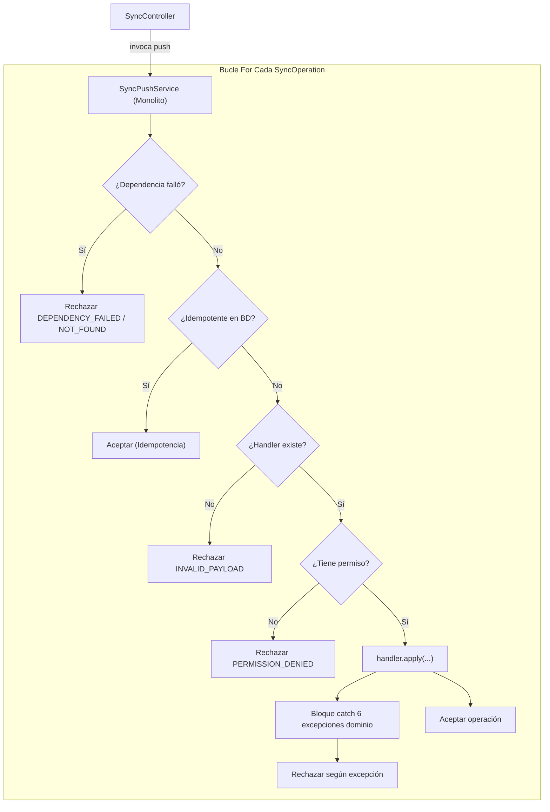
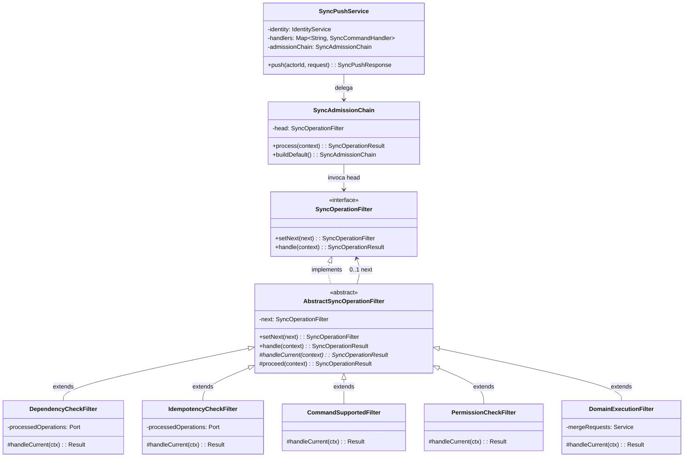

# Patrón de Comportamiento: Chain of Responsibility (Cadena de Responsabilidad)

## 1. Intención y Justificación

El patrón **Chain of Responsibility (Cadena de Responsabilidad)** permite desacoplar al emisor de una solicitud de sus receptores potenciales, encadenando múltiples objetos receptores y pasando la solicitud a lo largo de la cadena hasta que uno o más eslabones la procesen, admitan o cortocircuiten.

### El Problema Previo en Tu Vacuna PAI
En el backend del sistema (`/sync/push`), los dispositivos móviles envían lotes de operaciones clínicas offline (`SyncOperation`). Previamente, el servicio orquestador [`SyncPushService`](file:///C:/Users/Juliocrm/Documents/code/tu_vacuna_pai/services/api/src/main/java/com/pai/api/synchronization/service/SyncPushService.java) acumulaba en un único método `push()` un bucle monolítico imperativo de más de 80 líneas repleto de:
* Verificaciones condicionales encadenadas (`if (...) { reject(...); continue; }`).
* Comprobaciones de dependencias causales en lote y base de datos.
* Verificaciones de idempotencia local vs global.
* Búsqueda en mapas de handlers y validación de tipos de comando.
* Inspección de permisos de usuario (`actor.hasPermission`).
* Un bloque `try-catch` con captura de 6 jerarquías de excepciones de dominio para traducirlas a motivos de rechazo.

**Impacto negativo del diseño anterior:**
1. **Violación flagrante de SRP (Single Responsibility Principle):** Una sola clase orquestaba el lote, resolvía seguridad, controlaba idempotencia, validaba grafos causales y capturaba errores de dominio.
2. **Violación de OCP (Open/Closed Principle):** Agregar cualquier nueva regla de admisión (ejemplo: validación de reloj desincronizado, verificación de estado de la IPS o rate-limiting de sincronización) requería modificar directamente el bucle central de `push()` con más sentencias `if`, `continue` y dependencias inyectadas.
3. **Fragilidad y Dificultad de Testeo:** Para probar un rechazo por permisos o por idempotencia, era necesario inicializar todo el grafo de dependencias de `SyncPushService`.

### La Solución con Chain of Responsibility
Se extrae cada etapa de verificación en un **eslabón independiente de la cadena de admisión** (`SyncOperationFilter`), el cual evalúa un objeto de contexto inmutable/transversal ([`SyncOperationContext`](file:///C:/Users/Juliocrm/Documents/code/tu_vacuna_pai/services/api/src/main/java/com/pai/api/synchronization/service/chain/SyncOperationContext.java)), decidiendo si cortocircuita la ejecución (rechazando o aceptando inmediatamente la operación) o si cede el control al siguiente eslabón (`proceed(context)`).

---

## 2. Ubicación en el Backend

El patrón se ubica dentro del paquete de sincronización del servicio API:
* **Directorio raíz del patrón:**  
  [`services/api/src/main/java/com/pai/api/synchronization/service/chain/`](file:///C:/Users/Juliocrm/Documents/code/tu_vacuna_pai/services/api/src/main/java/com/pai/api/synchronization/service/chain/)
* **Contrato del Manejador (`Handler`):**  
  [`SyncOperationFilter.java`](file:///C:/Users/Juliocrm/Documents/code/tu_vacuna_pai/services/api/src/main/java/com/pai/api/synchronization/service/chain/SyncOperationFilter.java)
* **Clase Base Abstracta (`BaseHandler`):**  
  [`AbstractSyncOperationFilter.java`](file:///C:/Users/Juliocrm/Documents/code/tu_vacuna_pai/services/api/src/main/java/com/pai/api/synchronization/service/chain/AbstractSyncOperationFilter.java)
* **Objeto Contexto (`Context`):**  
  [`SyncOperationContext.java`](file:///C:/Users/Juliocrm/Documents/code/tu_vacuna_pai/services/api/src/main/java/com/pai/api/synchronization/service/chain/SyncOperationContext.java)
* **Objeto Resultado (`Result`):**  
  [`SyncOperationResult.java`](file:///C:/Users/Juliocrm/Documents/code/tu_vacuna_pai/services/api/src/main/java/com/pai/api/synchronization/service/chain/SyncOperationResult.java)
* **Eslabones Concretos (`ConcreteHandlers`):**  
  1. [`DependencyCheckFilter.java`](file:///C:/Users/Juliocrm/Documents/code/tu_vacuna_pai/services/api/src/main/java/com/pai/api/synchronization/service/chain/DependencyCheckFilter.java)
  2. [`IdempotencyCheckFilter.java`](file:///C:/Users/Juliocrm/Documents/code/tu_vacuna_pai/services/api/src/main/java/com/pai/api/synchronization/service/chain/IdempotencyCheckFilter.java)
  3. [`CommandSupportedFilter.java`](file:///C:/Users/Juliocrm/Documents/code/tu_vacuna_pai/services/api/src/main/java/com/pai/api/synchronization/service/chain/CommandSupportedFilter.java)
  4. [`PermissionCheckFilter.java`](file:///C:/Users/Juliocrm/Documents/code/tu_vacuna_pai/services/api/src/main/java/com/pai/api/synchronization/service/chain/PermissionCheckFilter.java)
  5. [`DomainExecutionFilter.java`](file:///C:/Users/Juliocrm/Documents/code/tu_vacuna_pai/services/api/src/main/java/com/pai/api/synchronization/service/chain/DomainExecutionFilter.java)
* **Cadena / Ensamblador (`Chain`):**  
  [`SyncAdmissionChain.java`](file:///C:/Users/Juliocrm/Documents/code/tu_vacuna_pai/services/api/src/main/java/com/pai/api/synchronization/service/chain/SyncAdmissionChain.java)
* **Cliente / Consumidor (`Client`):**  
  [`SyncPushService.java`](file:///C:/Users/Juliocrm/Documents/code/tu_vacuna_pai/services/api/src/main/java/com/pai/api/synchronization/service/SyncPushService.java)
* **Pruebas Unitarias Automatizadas:**  
  * Pruebas de la Cadena: [`SyncAdmissionChainTest.java`](file:///C:/Users/Juliocrm/Documents/code/tu_vacuna_pai/services/api/src/test/java/com/pai/api/synchronization/service/chain/SyncAdmissionChainTest.java)
  * Pruebas Integradas de Push: [`SyncPushServiceTest.java`](file:///C:/Users/Juliocrm/Documents/code/tu_vacuna_pai/services/api/src/test/java/com/pai/api/synchronization/service/SyncPushServiceTest.java)

---

## 3. Matriz de Roles del Patrón (GoF)

| Rol GoF | Componente en Tu Vacuna PAI | Responsabilidad |
| :--- | :--- | :--- |
| **`Client`** | [`SyncPushService`](file:///C:/Users/Juliocrm/Documents/code/tu_vacuna_pai/services/api/src/main/java/com/pai/api/synchronization/service/SyncPushService.java) | Itera las operaciones del lote, crea el [`SyncOperationContext`](file:///C:/Users/Juliocrm/Documents/code/tu_vacuna_pai/services/api/src/main/java/com/pai/api/synchronization/service/chain/SyncOperationContext.java) y delega la decisión a la cadena. |
| **`Handler`** | [`SyncOperationFilter`](file:///C:/Users/Juliocrm/Documents/code/tu_vacuna_pai/services/api/src/main/java/com/pai/api/synchronization/service/chain/SyncOperationFilter.java) *(interface)* | Define el contrato abstracto para encadenar (`setNext`) y manejar la operación (`handle`). |
| **`BaseHandler`** | [`AbstractSyncOperationFilter`](file:///C:/Users/Juliocrm/Documents/code/tu_vacuna_pai/services/api/src/main/java/com/pai/api/synchronization/service/chain/AbstractSyncOperationFilter.java) *(abstract)* | Administra la referencia `next` y el método plantilla `proceed(context)` para delegar al sucesor. |
| **`ConcreteHandler 1`** | [`DependencyCheckFilter`](file:///C:/Users/Juliocrm/Documents/code/tu_vacuna_pai/services/api/src/main/java/com/pai/api/synchronization/service/chain/DependencyCheckFilter.java) | Valida dependencias causales en lote y base de datos (`DEPENDENCY_FAILED` / `DEPENDENCY_NOT_FOUND`). |
| **`ConcreteHandler 2`** | [`IdempotencyCheckFilter`](file:///C:/Users/Juliocrm/Documents/code/tu_vacuna_pai/services/api/src/main/java/com/pai/api/synchronization/service/chain/IdempotencyCheckFilter.java) | Detecta si la operación ya fue procesada (`ProcessedOperationsPort`), aceptándola de inmediato sin re-ejecutar. |
| **`ConcreteHandler 3`** | [`CommandSupportedFilter`](file:///C:/Users/Juliocrm/Documents/code/tu_vacuna_pai/services/api/src/main/java/com/pai/api/synchronization/service/chain/CommandSupportedFilter.java) | Verifica que el comando esté registrado en el catálogo de estrategias (`SyncCommandHandler`). |
| **`ConcreteHandler 4`** | [`PermissionCheckFilter`](file:///C:/Users/Juliocrm/Documents/code/tu_vacuna_pai/services/api/src/main/java/com/pai/api/synchronization/service/chain/PermissionCheckFilter.java) | Valida que el `actor` posea el permiso requerido por el comando (`PERMISSION_DENIED`). |
| **`ConcreteHandler 5`** | [`DomainExecutionFilter`](file:///C:/Users/Juliocrm/Documents/code/tu_vacuna_pai/services/api/src/main/java/com/pai/api/synchronization/service/chain/DomainExecutionFilter.java) | Ejecuta el comando en el servicio de dominio y traduce las excepciones de negocio a rechazos estandarizados. |
| **`Context`** | [`SyncOperationContext`](file:///C:/Users/Juliocrm/Documents/code/tu_vacuna_pai/services/api/src/main/java/com/pai/api/synchronization/service/chain/SyncOperationContext.java) | Portador de los datos de la solicitud (actor, operación, mapa de handlers, resultados acumulados del lote). |
| **`Result`** | [`SyncOperationResult`](file:///C:/Users/Juliocrm/Documents/code/tu_vacuna_pai/services/api/src/main/java/com/pai/api/synchronization/service/chain/SyncOperationResult.java) | Objeto de valor inmutable (record) con estado de aceptación y detalle de rechazo (`RejectedOperation`). |

---

## 4. Código del ANTES (Sin Patrón Chain of Responsibility)

En el código original, [`SyncPushService`](file:///C:/Users/Juliocrm/Documents/code/tu_vacuna_pai/services/api/src/main/java/com/pai/api/synchronization/service/SyncPushService.java) acumulaba todas las responsabilidades en su método `push`:

```java
// CÓDIGO ORIGINAL ANTES DE APLICAR EL PATRÓN
@Service
public class SyncPushService {
  private final IdentityService identity;
  private final PatientMergeRequestService mergeRequests;
  private final ProcessedOperationsPort processedOperations;
  private final Map<String, SyncCommandHandler> handlers;

  public SyncPushResponse push(UUID actorId, SyncPushRequest request) {
    AuthorizedUser actor = identity.resolve(actorId);
    List<UUID> accepted = new ArrayList<>();
    List<RejectedOperation> rejected = new ArrayList<>();
    Map<UUID, Boolean> outcomes = new HashMap<>();

    for (SyncOperation operation : Strings.safe(request.operations())) {
      UUID operationId = operation.operationId();

      // 1. Verificación imperativa de dependencias
      String dependencyReason = dependencyRejection(operation, outcomes);
      if (dependencyReason != null) {
        reject(rejected, outcomes, operationId, dependencyReason, "Dependencia no satisfecha.");
        continue;
      }

      // 2. Verificación imperativa de idempotencia
      if (processedOperations.exists(operationId.toString())) {
        accepted.add(operationId);
        outcomes.put(operationId, true);
        continue;
      }

      // 3. Verificación de comando soportado
      SyncCommandHandler handler = handlers.get(operation.commandType());
      if (handler == null) {
        reject(rejected, outcomes, operationId, REASON_INVALID_PAYLOAD,
            "Comando no soportado: " + operation.commandType());
        continue;
      }

      // 4. Verificación de permisos de seguridad
      String permission = handler.permission();
      if (permission != null && !actor.hasPermission(permission)) {
        reject(rejected, outcomes, operationId, REASON_PERMISSION_DENIED,
            "El permiso actual no autoriza la operacion.");
        continue;
      }

      // 5. Ejecución y captura monolítica de excepciones de dominio
      try {
        handler.apply(actorId, operationId.toString(), operation);
        accepted.add(operationId);
        outcomes.put(operationId, true);
      } catch (PatientAlreadyExistsException ex) {
        mergeRequests.requestReview(ex.getExistingPatientId());
        reject(rejected, outcomes, operationId, REASON_DUPLICATE, ex.getMessage());
      } catch (PatientNotFoundException | AttentionNotFoundException ex) {
        reject(rejected, outcomes, operationId, REASON_DEPENDENCY_NOT_FOUND, ex.getMessage());
      } catch (InvalidClinicalStateException | InvalidCatalogSelectionException ex) {
        reject(rejected, outcomes, operationId, REASON_INVALID_STATE, ex.getMessage());
      } catch (PermissionDeniedException | ScopeViolationException ex) {
        reject(rejected, outcomes, operationId, REASON_PERMISSION_DENIED, ex.getMessage());
      } catch (UserNotActiveException ex) {
        reject(rejected, outcomes, operationId, REASON_USER_NOT_ACTIVE, ex.getMessage());
      } catch (IllegalArgumentException ex) {
        reject(rejected, outcomes, operationId, REASON_INVALID_PAYLOAD, ex.getMessage());
      }
    }

    return new SyncPushResponse(accepted, rejected);
  }
}
```

---

## 5. Diagrama del ANTES

El diagrama en formato Draw.io se encuentra en:
* Archivo editable: [`chain-of-responsibility-before.drawio`](file:///C:/Users/Juliocrm/Documents/code/tu_vacuna_pai/docs/patterns-design/comportamiento/chain-of-responsibility/chain-of-responsibility-before.drawio)

### Visualización Conceptual del Monolito Anterior:



---

## 6. Código del DESPUÉS (Con Chain of Responsibility)

### 6.1. Contrato del Manejador (`SyncOperationFilter.java`)
```java
package com.pai.api.synchronization.service.chain;

public interface SyncOperationFilter {
  SyncOperationFilter setNext(SyncOperationFilter next);
  SyncOperationResult handle(SyncOperationContext context);
}
```

### 6.2. Clase Base Abstracta (`AbstractSyncOperationFilter.java`)
```java
package com.pai.api.synchronization.service.chain;

public abstract class AbstractSyncOperationFilter implements SyncOperationFilter {
  private SyncOperationFilter next;

  @Override
  public SyncOperationFilter setNext(SyncOperationFilter next) {
    this.next = next;
    return next;
  }

  @Override
  public SyncOperationResult handle(SyncOperationContext context) {
    return handleCurrent(context);
  }

  protected abstract SyncOperationResult handleCurrent(SyncOperationContext context);

  protected SyncOperationResult proceed(SyncOperationContext context) {
    if (next != null) {
      return next.handle(context);
    }
    return SyncOperationResult.accept();
  }
}
```

### 6.3. Eslabones Concretos de la Cadena

#### Eslabón 1: Dependencias (`DependencyCheckFilter.java`)
```java
public class DependencyCheckFilter extends AbstractSyncOperationFilter {
  private final ProcessedOperationsPort processedOperations;

  public DependencyCheckFilter(ProcessedOperationsPort processedOperations) {
    this.processedOperations = processedOperations;
  }

  @Override
  protected SyncOperationResult handleCurrent(SyncOperationContext context) {
    SyncOperation operation = context.operation();
    Map<UUID, Boolean> outcomes = context.batchOutcomes();

    for (UUID dependency : Strings.safe(operation.dependencies())) {
      Boolean outcome = outcomes.get(dependency);
      if (outcome != null && !outcome) {
        return SyncOperationResult.reject(operation.operationId(), "DEPENDENCY_FAILED", "Dependencia no satisfecha.");
      }
      if (outcome == null && !processedOperations.exists(dependency.toString())) {
        return SyncOperationResult.reject(operation.operationId(), "DEPENDENCY_NOT_FOUND", "Dependencia no satisfecha.");
      }
    }
    return proceed(context);
  }
}
```

#### Eslabón 2: Idempotencia (`IdempotencyCheckFilter.java`)
```java
public class IdempotencyCheckFilter extends AbstractSyncOperationFilter {
  private final ProcessedOperationsPort processedOperations;

  public IdempotencyCheckFilter(ProcessedOperationsPort processedOperations) {
    this.processedOperations = processedOperations;
  }

  @Override
  protected SyncOperationResult handleCurrent(SyncOperationContext context) {
    UUID operationId = context.operation().operationId();
    if (processedOperations.exists(operationId.toString())) {
      return SyncOperationResult.accept(); // Cortocircuito favorable
    }
    return proceed(context);
  }
}
```

#### Eslabón 3: Comando Soportado (`CommandSupportedFilter.java`)
```java
public class CommandSupportedFilter extends AbstractSyncOperationFilter {
  @Override
  protected SyncOperationResult handleCurrent(SyncOperationContext context) {
    SyncOperation operation = context.operation();
    SyncCommandHandler handler = context.handlers().get(operation.commandType());

    if (handler == null) {
      return SyncOperationResult.reject(operation.operationId(), "INVALID_PAYLOAD",
          "Comando no soportado: " + operation.commandType());
    }
    context.setResolvedHandler(handler);
    return proceed(context);
  }
}
```

#### Eslabón 4: Permisos (`PermissionCheckFilter.java`)
```java
public class PermissionCheckFilter extends AbstractSyncOperationFilter {
  @Override
  protected SyncOperationResult handleCurrent(SyncOperationContext context) {
    SyncCommandHandler handler = context.resolvedHandler();
    String permission = handler.permission();

    if (permission != null && !context.actor().hasPermission(permission)) {
      return SyncOperationResult.reject(context.operation().operationId(), "PERMISSION_DENIED",
          "El permiso actual no autoriza la operacion.");
    }
    return proceed(context);
  }
}
```

#### Eslabón 5: Ejecución en Dominio (`DomainExecutionFilter.java`)
```java
public class DomainExecutionFilter extends AbstractSyncOperationFilter {
  private final PatientMergeRequestService mergeRequests;

  public DomainExecutionFilter(PatientMergeRequestService mergeRequests) {
    this.mergeRequests = mergeRequests;
  }

  @Override
  protected SyncOperationResult handleCurrent(SyncOperationContext context) {
    SyncOperation operation = context.operation();
    UUID operationId = operation.operationId();
    SyncCommandHandler handler = context.resolvedHandler();

    try {
      handler.apply(context.actorId(), operationId.toString(), operation);
      return SyncOperationResult.accept();
    } catch (PatientAlreadyExistsException ex) {
      mergeRequests.requestReview(ex.getExistingPatientId());
      return SyncOperationResult.reject(operationId, "DUPLICATE_BUSINESS_IDENTITY", ex.getMessage());
    } catch (PatientNotFoundException | AttentionNotFoundException ex) {
      return SyncOperationResult.reject(operationId, "DEPENDENCY_NOT_FOUND", ex.getMessage());
    } catch (InvalidClinicalStateException | InvalidCatalogSelectionException ex) {
      return SyncOperationResult.reject(operationId, "INVALID_STATE", ex.getMessage());
    } catch (PermissionDeniedException | ScopeViolationException ex) {
      return SyncOperationResult.reject(operationId, "PERMISSION_DENIED", ex.getMessage());
    } catch (UserNotActiveException ex) {
      return SyncOperationResult.reject(operationId, "USER_NOT_ACTIVE", ex.getMessage());
    } catch (IllegalArgumentException ex) {
      return SyncOperationResult.reject(operationId, "INVALID_PAYLOAD", ex.getMessage());
    }
  }
}
```

### 6.4. Ensamblador de la Cadena (`SyncAdmissionChain.java`)
```java
@Component
public class SyncAdmissionChain {
  private final SyncOperationFilter head;

  @Autowired
  public SyncAdmissionChain(
      ProcessedOperationsPort processedOperations,
      PatientMergeRequestService mergeRequests) {
    this(createDefaultFilters(processedOperations, mergeRequests));
  }

  public SyncAdmissionChain(SyncOperationFilter head) {
    this.head = head;
  }

  public SyncOperationResult process(SyncOperationContext context) {
    return head.handle(context);
  }

  private static SyncOperationFilter createDefaultFilters(
      ProcessedOperationsPort processedOperations,
      PatientMergeRequestService mergeRequests) {
    SyncOperationFilter dependencyFilter = new DependencyCheckFilter(processedOperations);
    SyncOperationFilter idempotencyFilter = new IdempotencyCheckFilter(processedOperations);
    SyncOperationFilter commandSupportedFilter = new CommandSupportedFilter();
    SyncOperationFilter permissionFilter = new PermissionCheckFilter();
    SyncOperationFilter domainExecutionFilter = new DomainExecutionFilter(mergeRequests);

    dependencyFilter
        .setNext(idempotencyFilter)
        .setNext(commandSupportedFilter)
        .setNext(permissionFilter)
        .setNext(domainExecutionFilter);

    return dependencyFilter;
  }

  public static SyncAdmissionChain buildDefault(
      ProcessedOperationsPort processedOperations,
      PatientMergeRequestService mergeRequests) {
    return new SyncAdmissionChain(createDefaultFilters(processedOperations, mergeRequests));
  }
}
```

### 6.5. Cliente Rediseñado (`SyncPushService.java`)
```java
@Service
public class SyncPushService {
  private final IdentityService identity;
  private final Map<String, SyncCommandHandler> handlers;
  private final SyncAdmissionChain admissionChain;

  @Autowired
  public SyncPushService(
      IdentityService identity,
      SyncAdmissionChain admissionChain,
      List<SyncCommandHandler> commandHandlers) {
    this.identity = identity;
    this.admissionChain = admissionChain;
    this.handlers = commandHandlers.stream()
        .collect(
            Collectors.toUnmodifiableMap(SyncCommandHandler::commandType, Function.identity()));
  }

  public SyncPushService(
      IdentityService identity,
      PatientMergeRequestService mergeRequests,
      ProcessedOperationsPort processedOperations,
      List<SyncCommandHandler> commandHandlers) {
    this(
        identity,
        SyncAdmissionChain.buildDefault(processedOperations, mergeRequests),
        commandHandlers);
  }

  public SyncPushResponse push(UUID actorId, SyncPushRequest request) {
    AuthorizedUser actor = identity.resolve(actorId);
    List<UUID> accepted = new ArrayList<>();
    List<RejectedOperation> rejected = new ArrayList<>();
    Map<UUID, Boolean> outcomes = new HashMap<>();

    for (SyncOperation operation : Strings.safe(request.operations())) {
      UUID operationId = operation.operationId();
      SyncOperationContext context = new SyncOperationContext(
          actorId,
          actor,
          operation,
          Collections.unmodifiableMap(outcomes),
          handlers);

      SyncOperationResult result = admissionChain.process(context);
      if (result.accepted()) {
        accepted.add(operationId);
        outcomes.put(operationId, true);
      } else {
        rejected.add(result.rejection());
        outcomes.put(operationId, false);
      }
    }

    return new SyncPushResponse(accepted, rejected);
  }
}
```

---

## 7. Diagrama del DESPUÉS

El diagrama en formato Draw.io se encuentra en:
* Archivo editable: [`chain-of-responsibility-after.drawio`](file:///C:/Users/Juliocrm/Documents/code/tu_vacuna_pai/docs/patterns-design/comportamiento/chain-of-responsibility/chain-of-responsibility-after.drawio)

### Visualización Arquitectónica de la Cadena:



---

## 8. Pruebas Unitarias y Verificación

La implementación cuenta con una suite completa de pruebas unitarias:

1. **[`SyncAdmissionChainTest`](file:///C:/Users/Juliocrm/Documents/code/tu_vacuna_pai/services/api/src/test/java/com/pai/api/synchronization/service/chain/SyncAdmissionChainTest.java)**:
   * `short_circuits_on_failed_dependency`: Verifica corte inmediato por dependencia insatisfecha.
   * `short_circuits_on_idempotent_processed_operation`: Verifica corte inmediato y aceptación ante operación ya persistida.
   * `short_circuits_on_unsupported_command`: Verifica corte cuando el comando no existe en los handlers.
   * `short_circuits_on_missing_permission`: Verifica corte por falta de permisos.
   * `passes_all_filters_and_executes_in_domain`: Verifica el flujo completo atravesando los 5 eslabones con éxito.
   * `allows_extending_chain_with_custom_filter`: Demuestra la extensibilidad en tiempo de diseño y ejecución agregando un eslabón sin tocar la clase cliente.

2. **[`SyncPushServiceTest`](file:///C:/Users/Juliocrm/Documents/code/tu_vacuna_pai/services/api/src/test/java/com/pai/api/synchronization/service/SyncPushServiceTest.java)**:
   * 8 pruebas integradas verificando lotes completos, generación de merge requests por duplicados y persistencia.

**Ejecución:**
```bash
./mvnw test -Dtest=SyncAdmissionChainTest,SyncPushServiceTest
# Resultado: Tests run: 14, Failures: 0, Errors: 0, Skipped: 0 -> BUILD SUCCESS
```

---

## 9. Beneficios e Invariantes SOLID Respaldados

* **SRP (Single Responsibility Principle):** Cada filtro tiene una única razón para cambiar. Si cambia la política de idempotencia, solo se edita `IdempotencyCheckFilter`; si cambian las excepciones de dominio, solo se edita `DomainExecutionFilter`.
* **OCP (Open/Closed Principle):** Se pueden añadir nuevos eslabones (filtros de auditoría, control horario o bloqueo institucional) sin tocar ni una sola línea de `SyncPushService`.
* **DIP (Dependency Inversion Principle):** `SyncPushService` depende de la abstracción `SyncAdmissionChain` y `SyncOperationFilter`, no de servicios concretos de base de datos ni de auditoría.
* **Mantenibilidad y Limpieza:** El método `push()` pasó de 60 líneas con código espagueti de `continue` a un bucle limpio de 15 líneas que crea el contexto y delega a la cadena.
