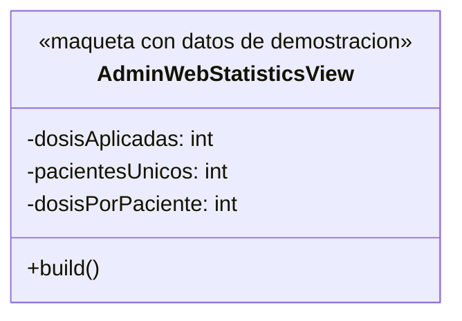
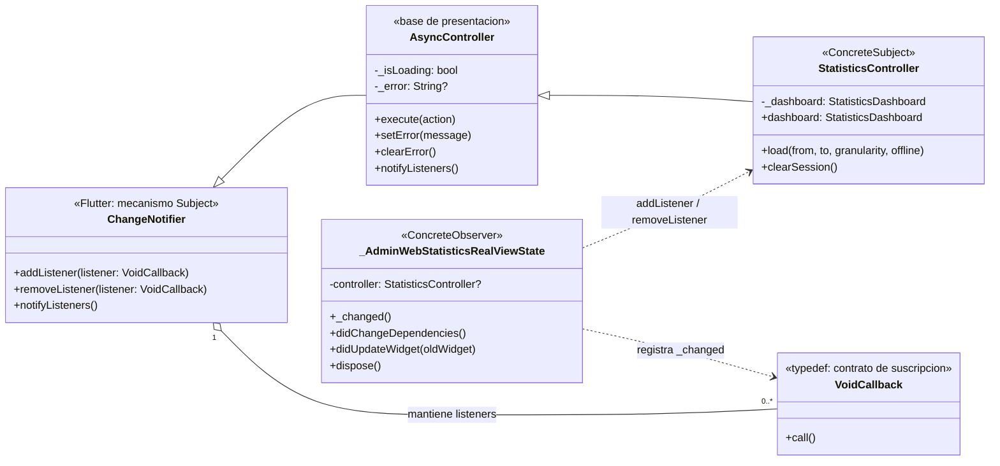

# Observer en Estadísticas Flutter

## Alcance y precisión

Esta explicación describe la implementación del módulo de Estadísticas en
`apps/mobile`. El código no declara clases llamadas `Subject` u `Observer` ni
implementa manualmente una interfaz GoF de observador. Aplica la estructura
mediante `ChangeNotifier` de Flutter y callbacks `VoidCallback`.

El diagrama «antes» es una simplificación didáctica de la maqueta anterior,
cuyos valores eran de demostración. No pretende reconstruir literalmente sus
clases ni su código histórico. El diagrama «después» sí representa las clases y
relaciones que existen en el código integrado.

## Diagrama conceptual: antes

En la maqueta, la vista presentaba métricas de demostración. No había un sujeto
que publicara cambios ni un observador suscrito a esos cambios.

El diagrama es intencionalmente sencillo: muestra una vista que conserva o
presenta cifras y las dibuja. No representa una clase `StatisticsController`
anterior ni afirma que existiera una suscripción Observer.

## Diagrama estructural: después

`ChangeNotifier` y `VoidCallback` pertenecen al SDK de Flutter/Dart, no son
clases creadas en este repositorio. En el patrón GoF, `ChangeNotifier` aporta
el mecanismo de `Subject`; `AsyncController` lo incorpora como clase base y
`StatisticsController` es el sujeto concreto que administra el estado
estadístico. El rol `Observer` se representa con el contrato callback
`VoidCallback`, y `_AdminWebStatisticsRealViewState` es el observador concreto.

La notificación no transporta una copia del dashboard. El callback indica que
el estado pudo cambiar; la vista vuelve a leer `dashboard`, `isLoading` y
`error` desde el controlador.

## Participantes y ubicación

Solo se enumeran aquí los participantes del diagrama estructural anterior y
las clases propias que cumplen esos roles. La interfaz `AdminWebStatisticsRealView`
configura la pantalla, pero no es quien se suscribe: esa responsabilidad está
en su clase `State`.

| Rol estructural | Tipo real | Ubicación |
|---|---|---|
| Mecanismo `Subject` | `ChangeNotifier` (Flutter) | SDK Flutter, importado indirectamente por `AsyncController` mediante `package:flutter/foundation.dart`; no tiene ubicación dentro del repositorio. |
| Base que expone el mecanismo de notificación | `AsyncController` | `apps/mobile/lib/core/presentation/async_controller.dart` |
| `ConcreteSubject` | `StatisticsController` | `apps/mobile/lib/features/dashboard/presentation/statistics_controller.dart` |
| Contrato de listener | `VoidCallback` (typedef de Dart) | SDK Flutter/Dart; no es una clase de este repositorio. |
| `ConcreteObserver` | `_AdminWebStatisticsRealViewState` | `apps/mobile/lib/features/dashboard/presentation/widgets/admin_web_statistics_real_view.dart` |

`StatisticsDashboard`, `StatisticsRepository`, `StatisticsRepositoryImpl`,
`ApiClient` y `AdminWebStatisticsRealView` no son participantes estructurales
del Observer: intervienen en el modelo de datos, persistencia, red o composición
de la pantalla, no en la suscripción/notificación.

## Por qué se aplicó

La pantalla necesita reflejar cambios asíncronos sin encargarse de coordinar
por sí misma cada transición de carga, error y datos. Si la vista tuviera que
consultar repetidamente el estado o conocer los detalles internos de la carga,
quedaría más acoplada al controlador y sería más fácil que mostrara un estado
desactualizado.

Observer separa dos responsabilidades: el controlador modifica y publica el
estado; la vista se suscribe y decide cómo volver a dibujarse. El controlador
no necesita conocer la estructura visual que recibirá su notificación.

## Cómo funciona en este módulo

1. `StatisticsController` conserva el estado actual en `_dashboard` y hereda
   de `AsyncController`, que a su vez extiende `ChangeNotifier`.
2. Al iniciarse el `State` de la vista, `didChangeDependencies` registra el
   callback `_changed` con `addListener`. `_loaded` evita registrar o cargar
   repetidamente desde ese ciclo de vida.
3. Si hay una respuesta local cacheada, `load` la asigna a `_dashboard` y llama
   a `notifyListeners` para que se muestre sin esperar la consulta remota.
4. En línea, `AsyncController.execute` notifica al iniciar la carga, ejecuta la
   acción autenticada y notifica al terminar. La acción reemplaza `_dashboard`
   con la respuesta remota; `execute` publica el resultado junto con la
   transición final de carga o error.
5. `_changed` comprueba `mounted` y llama a `setState`; durante la reconstrucción
   el widget vuelve a leer los valores actuales del controlador.
6. Si cambia la instancia del controlador, `didUpdateWidget` retira el callback
   de la instancia anterior y lo registra en la nueva. Al destruirse el `State`,
   `dispose` elimina la suscripción.

Además, `AsyncController.notifyListeners` evita emitir después de su `dispose`.
La validación de periodo usa `setError`, que también notifica; `clearSession`
restablece el dashboard, limpia el error y publica el cambio.

## Para qué sirve aquí

- Mantener la interfaz sincronizada con los datos cacheados y remotos.
- Reflejar las transiciones de carga y los errores sin que el widget administre
  el ciclo de autenticación o la consulta HTTP.
- Reducir el conocimiento directo entre el sujeto que cambia y la vista que
  reacciona.
- Permitir que más de un listener observe el controlador sin que este tenga
  que mantener referencias a cada pantalla.

Observer coordina notificaciones; no obtiene los datos, no define el formato
del dashboard y no implementa la caché. Esas tareas pertenecen al controlador,
al repositorio y a la entidad de dominio, respectivamente.

## Explicación técnica, directa

`ChangeNotifier` mantiene callbacks registrados y los ejecuta cuando se llama
a `notifyListeners()`. `StatisticsController` cambia su estado y publica esa
notificación. `_AdminWebStatisticsRealViewState` registra `_changed` como
callback; al ejecutarse, este verifica que el `State` siga montado y solicita
una reconstrucción mediante `setState`. En la reconstrucción, la vista consulta
el estado actualizado del controlador. La suscripción se mantiene mientras la
vista usa esa instancia y se elimina al reemplazarla o destruir el `State`.

La dependencia es observable en una dirección: la vista conoce al controlador
para suscribirse y leer su estado; el controlador no depende de la vista. El
contrato de notificación es un callback sin argumentos, por lo que la vista
consulta el estado actual en lugar de recibir un evento con una carga útil.

## Explicación sencilla, sin analogías

Un objeto guarda el estado. Cuando ese estado cambia, avisa a quienes se
registraron para recibir avisos. La vista se registra, recibe el aviso y vuelve
a dibujarse leyendo el estado actualizado. Cuando deja de existir, se elimina
del registro. Así, quien cambia el estado no necesita conocer la vista.

## Mejoras posibles a futuro

- **Un estado de presentación explícito e inmutable.** Agrupar datos, carga,
  error y origen (`server`/`cache`) en un estado único reduce combinaciones
  ambiguas y hace más fácil razonar sobre qué debe mostrarse.
- **Usar `ListenableBuilder` o `AnimatedBuilder`.** Puede reemplazar la pareja
  manual `addListener`/`removeListener` y limitar la reconstrucción al subárbol
  que depende del controlador. Conviene seguir el patrón ya adoptado por la
  aplicación y no añadir otra librería de estado solo para esto.
- **Definir el comportamiento al reemplazar el controlador.** Actualmente
  `didUpdateWidget` cambia la suscripción, pero no vuelve a llamar a `_load`.
  Si se espera cargar automáticamente al recibir una instancia nueva, se puede
  añadir esa transición de forma explícita.
- **Proteger consultas concurrentes.** Si cambian rápidamente periodo o
  granularidad, una respuesta anterior podría terminar después de una más
  reciente. Un identificador incremental de solicitud o cancelación puede
  impedir que esa respuesta antigua sobrescriba el estado actual.
- **Probar el contrato de observación.** Añadir pruebas que verifiquen
  notificaciones por caché, inicio y fin de carga, error y limpieza; también
  verificar que al reemplazar o destruir la vista se retire el listener.
- **Separar estados simultáneos de caché y actualización remota.** Una respuesta
  cacheada puede seguir visible mientras una consulta remota está en curso o
  falla. Un estado explícito puede comunicar esa condición sin descartar datos
  útiles ni ocultar el error.

Estas mejoras son evoluciones posibles, no requisitos para que la
implementación actual de Observer funcione.