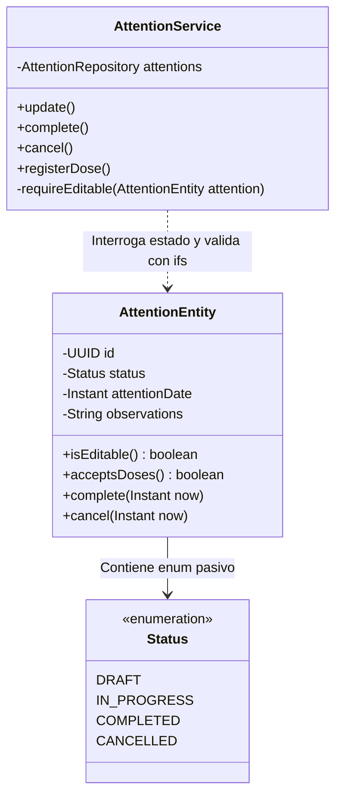
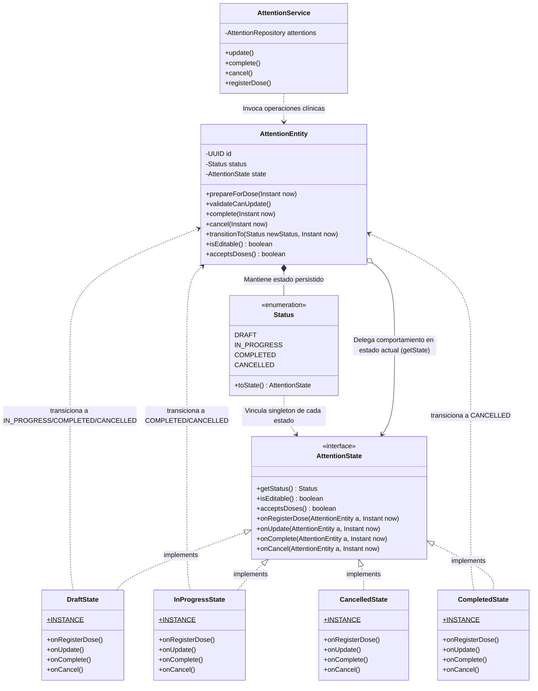

# Patrón de Comportamiento: State (GoF) — Ciclo de Vida Clínico de Atenciones

El patrón **State** permite a un objeto alterar su comportamiento cuando su estado interno cambia. El objeto parecerá haber cambiado de clase, delegando la ejecución de sus operaciones en objetos que representan su estado actual.

En **Tu Vacuna PAI**, este patrón se implementó en el backend (módulo `com.pai.api.attentions`) para modelar y gobernar formalmente las transiciones del ciclo de vida de la atención clínica de vacunación:
$$\text{DRAFT} \xrightarrow{\text{primer registro de dosis}} \text{IN\_PROGRESS} \xrightarrow{\text{cierre formal}} \text{COMPLETED} \quad (\text{o } \text{CANCELLED con motivo})$$

---

## 1. Sección "Antes": Contexto, Problema y Violación de Principios SOLID

### 1.1. Contexto de lo que pasaba en la aplicación
Antes de aplicar el patrón, el agregado raíz de la atención clínica (`AttentionEntity`) almacenaba únicamente un enumerado pasivo (`Status status`):
- `DRAFT`: Creada sin dosis o en borrador.
- `IN_PROGRESS`: En atención.
- `COMPLETED`: Sellada y cerrada.
- `CANCELLED`: Anulada con justificación.

Sin embargo, **la entidad no gobernaba su propio comportamiento ni sus transiciones**. En su lugar:
1. `AttentionEntity` se limitaba a exponer métodos booleanos anémicos con condicionales `if` cableados:
   ```java
   public boolean isEditable() {
     return status == Status.DRAFT || status == Status.IN_PROGRESS;
   }
   public boolean acceptsDoses() {
     return isEditable();
   }
   ```
2. La lógica de negocio, validaciones de qué acciones estaban permitidas y el rechazo de operaciones inválidas se encontraban **dispersas e interrogadas externamente en `AttentionService`**:
   - `AttentionService.registerDose()` preguntaba externamente con `if (!attention.acceptsDoses())`.
   - `AttentionService.cancel()` comprobaba manualmente `if (attention.getStatus() == Status.CANCELLED)`.
   - `AttentionService.update()` y `complete()` llamaban a un método helper procedural `requireEditable(attention)` con más bifurcaciones `if`.
3. Ninguna clase centralizaba qué transiciones eran válidas entre estados (por ejemplo, transicionar automáticamente a `IN_PROGRESS` cuando se aplica la primera dosis).

### 1.2. Principios SOLID que se incumplían

1. **Violación de Single Responsibility Principle (SRP):**
   - `AttentionService` asumía dos responsabilidades no relacionadas: orquestar la transacción / casos de uso de la aplicación Y además fiscalizar proceduralmente las reglas de transición y estados internos del agregado clínico.
   - `AttentionEntity` actuaba como un contenedor anémico de datos para JPA mientras sus reglas de ciclo de vida estaban fugadas en la capa de servicios.

2. **Violación de Open/Closed Principle (OCP):**
   - Si se requería introducir un nuevo estado en el ciclo de vida clínico (por ejemplo, `UNDER_REVIEW`, `QUARANTINED` o `ARCHIVED`), era obligatorio modificar múltiples métodos en `AttentionService` (`registerDose`, `cancel`, `update`, `complete`), alterando los bloques `if-else` y `switch` con alto riesgo de regresión en código productivo.

3. **Infracción de "Tell, Don't Ask":**
   - El servicio interrogaba al objeto sobre su estado (`getStatus() == CANCELLED`, `!acceptsDoses()`) para luego tomar decisiones por él, en lugar de invocar una operación polimórfica en la entidad y que su estado decida si la permite o no.

### 1.3. Código original donde se encontraba el problema

#### En `com.pai.api.attentions.entity.AttentionEntity.java` (Fragmento Antes):
```java
public class AttentionEntity {

  public enum Status {
    DRAFT,
    IN_PROGRESS,
    COMPLETED,
    CANCELLED
  }

  // ... atributos persistidos ...
  private Status status;

  // LÓGICA ANÉMICA / CONDICIONALES CABLEADOS:
  public boolean isEditable() {
    return status == Status.DRAFT || status == Status.IN_PROGRESS;
  }

  public boolean acceptsDoses() {
    return isEditable();
  }

  // Mutaciones sin validación interna de estados:
  public void complete(Instant now) {
    this.status = Status.COMPLETED;
    this.updatedAt = now;
  }

  public void cancel(Instant now) {
    this.status = Status.CANCELLED;
    this.updatedAt = now;
  }
}
```

#### En `com.pai.api.attentions.service.AttentionService.java` (Fragmento Antes):
```java
public class AttentionService {

  public AttentionResponse update(UUID actorId, UUID attentionId, UpdateAttentionRequest request) {
    AttentionEntity attention = requireScoped(actor, attentionId);
    requireEditable(attention); // <-- Comprobación procedural manual
    // ...
  }

  public AttentionResponse complete(UUID actorId, String operationId, UUID attentionId) {
    // ...
    AttentionEntity attention = requireScoped(actor, attentionId);
    requireEditable(attention); // <-- Comprobación procedural manual
    attention.complete(Instant.now());
    // ...
  }

  public AttentionResponse cancel(UUID actorId, UUID attentionId, CancelAttentionRequest request) {
    AttentionEntity attention = requireScoped(actor, attentionId);
    // Control condicional manual disperso:
    if (attention.getStatus() == AttentionEntity.Status.CANCELLED) {
      throw new InvalidClinicalStateException("La atencion ya esta anulada.");
    }
    attention.cancel(Instant.now());
    // ...
  }

  public AppliedDoseResponse registerDose(...) {
    // ...
    AttentionEntity attention = requireScoped(actor, attentionId);
    // Verificación externa de capacidad de estado:
    if (!attention.acceptsDoses()) {
      throw new InvalidClinicalStateException(
          "No se pueden registrar dosis en una atencion completada o anulada.");
    }
    // ...
  }

  // Helper procedural que concentra los if de estado:
  private void requireEditable(AttentionEntity attention) {
    if (!attention.isEditable()) {
      throw new InvalidClinicalStateException(
          "La atencion no se puede modificar en su estado actual (" + attention.getStatus() + ").");
    }
  }
}
```

### 1.4. Relación de clases Antes (Diagrama Mermaid)



---

## 2. Sección "Después": Aplicación del Patrón State y Mejoras Logradas

### 2.1. Lo que se cambió concretamente y qué mejoró
1. **Creación de la abstracción de estado (`AttentionState`):** Se definió una interfaz de comportamiento que declara las operaciones sensibles al estado del ciclo de vida clínico:
   - `onRegisterDose(AttentionEntity, Instant)`
   - `onUpdate(AttentionEntity, Instant)`
   - `onComplete(AttentionEntity, Instant)`
   - `onCancel(AttentionEntity, Instant)`
   - `isEditable()` y `acceptsDoses()`

2. **Implementación de Estados Concretos Polimórficos (`ConcreteState`):**
   - `DraftState`: Permite edición, avance a `IN_PROGRESS` con la primera dosis, cierre y cancelación.
   - `InProgressState`: Permite múltiples dosis acumuladas, edición, cierre y cancelación.
   - `CompletedState`: Estado terminal sellado. Lanza `InvalidClinicalStateException` si se intenta editar, añadir dosis o completar de nuevo. Admite anulación justificada si el negocio institucional lo requiere.
   - `CancelledState`: Estado terminal nulo. Rechaza cualquier modificación o nueva cancelación informando que la atención ya está anulada.

3. **La Entidad como Contexto (`AttentionEntity`) y el Enum `Status`:**
   - Cada constante del enum `Status` (`DRAFT`, `IN_PROGRESS`, `COMPLETED`, `CANCELLED`) vincula directamente su respectivo `ConcreteState` singleton mediante `toState()`.
   - Se elimina la necesidad de clases factoría intermedias o anotaciones mágicas `@PostLoad`.
   - La entidad delega sus operaciones clínicas en `getState().onX(...)`, aplicando el principio *"Tell, Don't Ask"*.

4. **Simplificación radical de `AttentionService`:**
   - Se eliminaron todos los `if (!attention.acceptsDoses())`, `if (attention.getStatus() == CANCELLED)` y el método `requireEditable()`.
   - El servicio ahora simplemente le indica al agregado qué desea hacer (`attention.prepareForDose()`, `attention.validateCanUpdate()`, `attention.complete()`, `attention.cancel()`) y la clase del estado actual ejecuta la lógica o rechaza con la excepción adecuada.

5. **Beneficios SOLID obtenidos:**
   - **SRP:** Las reglas de cada estado están aisladas en su propia clase de menos de 40 líneas. `AttentionService` solo coordina transacciones y persistencia.
   - **OCP:** Agregar un nuevo estado como `UNDER_REVIEW` solo requiere crear una clase `UnderReviewState` implementando `AttentionState` y agregar la constante al enum `Status`, sin tocar ni una sola línea de `AttentionService`.

---

### 2.2. Clases creadas y modificadas

| Acción | Clase / Archivo | Rol GoF |
|---|---|---|
| **Creada** | `com.pai.api.attentions.state.AttentionState` | **State** (Interfaz abstracta de comportamiento) |
| **Creada** | `com.pai.api.attentions.state.DraftState` | **ConcreteState** (Comportamiento en borrador) |
| **Creada** | `com.pai.api.attentions.state.InProgressState` | **ConcreteState** (Comportamiento en curso) |
| **Creada** | `com.pai.api.attentions.state.CompletedState` | **ConcreteState** (Comportamiento sellado/inmutable) |
| **Creada** | `com.pai.api.attentions.state.CancelledState` | **ConcreteState** (Comportamiento anulado) |
| **Modificada** | `com.pai.api.attentions.entity.AttentionEntity` | **Context** (Mantiene el estado y delega en él) |
| **Modificada** | `com.pai.api.attentions.service.AttentionService` | **Client** (Invoca operaciones sin interrogaciones de estado) |
| **Creada** | `com.pai.api.attentions.state.AttentionStateTest` | **Unit Test Suite** (17 pruebas unitarias automatizadas) |

---

### 2.3. Código Completo de las Clases del Patrón

#### 1. Interfaz `AttentionState.java`
```java
package com.pai.api.attentions.state;

import com.pai.api.attentions.entity.AttentionEntity;
import java.time.Instant;

/**
 * Contrato del patron GoF State para el ciclo de vida de {@link AttentionEntity}.
 *
 * <p>Encapsula las reglas clinicas y transiciones permitidas segun el estado
 * actual de la atencion, eliminando validaciones condicionales dispersas en
 * {@code AttentionService} y entidades de persistencia.
 */
public interface AttentionState {

  /** Estado del enum correspondiente. */
  AttentionEntity.Status getStatus();

  /** Indica si la atencion admite modificaciones en sus datos generales. */
  boolean isEditable();

  /** Indica si la atencion puede admitir nuevas dosis aplicadas. */
  boolean acceptsDoses();

  /**
   * Valida y ejecuta la transicion previa al registro de una dosis.
   * Si la atencion estaba en DRAFT, avanza a IN_PROGRESS.
   */
  void onRegisterDose(AttentionEntity attention, Instant now);

  /** Valida si se pueden actualizar los detalles de la atencion. */
  void onUpdate(AttentionEntity attention, Instant now);

  /** Valida y ejecuta el cierre de la atencion (COMPLETED). */
  void onComplete(AttentionEntity attention, Instant now);

  /** Valida y ejecuta la anulacion de la atencion (CANCELLED). */
  void onCancel(AttentionEntity attention, Instant now);
}
```

#### 2. `DraftState.java`
```java
package com.pai.api.attentions.state;

import com.pai.api.attentions.entity.AttentionEntity;
import java.time.Instant;

public final class DraftState implements AttentionState {

  public static final DraftState INSTANCE = new DraftState();

  private DraftState() {}

  @Override
  public AttentionEntity.Status getStatus() {
    return AttentionEntity.Status.DRAFT;
  }

  @Override
  public boolean isEditable() {
    return true;
  }

  @Override
  public boolean acceptsDoses() {
    return true;
  }

  @Override
  public void onRegisterDose(AttentionEntity attention, Instant now) {
    // Primera dosis aplicada: la atencion avanza formalmente a EN CURSO
    attention.transitionTo(AttentionEntity.Status.IN_PROGRESS, now);
  }

  @Override
  public void onUpdate(AttentionEntity attention, Instant now) {
    // Permitido en borrador
  }

  @Override
  public void onComplete(AttentionEntity attention, Instant now) {
    attention.transitionTo(AttentionEntity.Status.COMPLETED, now);
  }

  @Override
  public void onCancel(AttentionEntity attention, Instant now) {
    attention.transitionTo(AttentionEntity.Status.CANCELLED, now);
  }
}
```

#### 3. `InProgressState.java`
```java
package com.pai.api.attentions.state;

import com.pai.api.attentions.entity.AttentionEntity;
import java.time.Instant;

public final class InProgressState implements AttentionState {

  public static final InProgressState INSTANCE = new InProgressState();

  private InProgressState() {}

  @Override
  public AttentionEntity.Status getStatus() {
    return AttentionEntity.Status.IN_PROGRESS;
  }

  @Override
  public boolean isEditable() {
    return true;
  }

  @Override
  public boolean acceptsDoses() {
    return true;
  }

  @Override
  public void onRegisterDose(AttentionEntity attention, Instant now) {
    // Ya esta en progreso: acepta dosis adicionales sin cambio de estado
  }

  @Override
  public void onUpdate(AttentionEntity attention, Instant now) {
    // Permitido en progreso
  }

  @Override
  public void onComplete(AttentionEntity attention, Instant now) {
    attention.transitionTo(AttentionEntity.Status.COMPLETED, now);
  }

  @Override
  public void onCancel(AttentionEntity attention, Instant now) {
    attention.transitionTo(AttentionEntity.Status.CANCELLED, now);
  }
}
```

#### 4. `CompletedState.java`
```java
package com.pai.api.attentions.state;

import com.pai.api.attentions.entity.AttentionEntity;
import com.pai.api.attentions.exception.InvalidClinicalStateException;
import java.time.Instant;

public final class CompletedState implements AttentionState {

  public static final CompletedState INSTANCE = new CompletedState();

  private CompletedState() {}

  @Override
  public AttentionEntity.Status getStatus() {
    return AttentionEntity.Status.COMPLETED;
  }

  @Override
  public boolean isEditable() {
    return false;
  }

  @Override
  public boolean acceptsDoses() {
    return false;
  }

  @Override
  public void onRegisterDose(AttentionEntity attention, Instant now) {
    throw new InvalidClinicalStateException(
        "No se pueden registrar dosis en una atencion completada o anulada.");
  }

  @Override
  public void onUpdate(AttentionEntity attention, Instant now) {
    throw new InvalidClinicalStateException(
        "La atencion no se puede modificar en su estado actual (COMPLETED).");
  }

  @Override
  public void onComplete(AttentionEntity attention, Instant now) {
    throw new InvalidClinicalStateException(
        "La atencion no se puede modificar en su estado actual (COMPLETED).");
  }

  @Override
  public void onCancel(AttentionEntity attention, Instant now) {
    attention.transitionTo(AttentionEntity.Status.CANCELLED, now);
  }
}
```

#### 5. `CancelledState.java`
```java
package com.pai.api.attentions.state;

import com.pai.api.attentions.entity.AttentionEntity;
import com.pai.api.attentions.exception.InvalidClinicalStateException;
import java.time.Instant;

public final class CancelledState implements AttentionState {

  public static final CancelledState INSTANCE = new CancelledState();

  private CancelledState() {}

  @Override
  public AttentionEntity.Status getStatus() {
    return AttentionEntity.Status.CANCELLED;
  }

  @Override
  public boolean isEditable() {
    return false;
  }

  @Override
  public boolean acceptsDoses() {
    return false;
  }

  @Override
  public void onRegisterDose(AttentionEntity attention, Instant now) {
    throw new InvalidClinicalStateException(
        "No se pueden registrar dosis en una atencion completada o anulada.");
  }

  @Override
  public void onUpdate(AttentionEntity attention, Instant now) {
    throw new InvalidClinicalStateException(
        "La atencion no se puede modificar en su estado actual (CANCELLED).");
  }

  @Override
  public void onComplete(AttentionEntity attention, Instant now) {
    throw new InvalidClinicalStateException(
        "No se puede completar una atencion anulada.");
  }

  @Override
  public void onCancel(AttentionEntity attention, Instant now) {
    throw new InvalidClinicalStateException("La atencion ya esta anulada.");
  }
}
```

#### 6. Modificación en `AttentionEntity.java` (Fragmento Destacado)
```java
  public enum Status {
    DRAFT,
    IN_PROGRESS,
    COMPLETED,
    CANCELLED;

    public AttentionState toState() {
      if (this == IN_PROGRESS) {
        return InProgressState.INSTANCE;
      }
      if (this == COMPLETED) {
        return CompletedState.INSTANCE;
      }
      if (this == CANCELLED) {
        return CancelledState.INSTANCE;
      }
      return DraftState.INSTANCE;
    }
  }

  @Enumerated(EnumType.STRING)
  @Column(nullable = false)
  private Status status;

  public AttentionEntity(..., Instant now) {
    // ...
    this.status = Status.DRAFT;
    this.createdAt = now;
    this.updatedAt = now;
  }

  public AttentionState getState() {
    return status != null ? status.toState() : DraftState.INSTANCE;
  }

  public boolean isEditable() {
    return getState().isEditable();
  }

  public boolean acceptsDoses() {
    return getState().acceptsDoses();
  }

  public void prepareForDose(Instant now) {
    getState().onRegisterDose(this, now);
  }

  public void validateCanUpdate() {
    getState().onUpdate(this, Instant.now());
  }

  public void complete(Instant now) {
    getState().onComplete(this, now);
  }

  public void cancel(Instant now) {
    getState().onCancel(this, now);
  }

  public void transitionTo(Status newStatus, Instant now) {
    this.status = newStatus;
    this.updatedAt = now;
  }
```

#### 8. Modificación en `AttentionService.java` (Fragmento Destacado)
```java
  @Transactional
  public AttentionResponse update(UUID actorId, UUID attentionId, UpdateAttentionRequest request) {
    AuthorizedUser actor = identity.resolve(actorId);
    AttentionEntity attention = requireScoped(actor, attentionId);
    attention.validateCanUpdate(); // <-- Delegación polimórfica directa

    if (attention.getVersion() != request.version()) {
      throw new OptimisticCatalogException("La atencion fue modificada por otro usuario.");
    }
    // ...
  }

  @Transactional
  public AttentionResponse complete(UUID actorId, String operationId, UUID attentionId) {
    // ...
    AuthorizedUser actor = identity.resolve(actorId);
    AttentionEntity attention = requireScoped(actor, attentionId);
    attention.complete(Instant.now()); // <-- El estado valida y transiciona
    attentions.save(attention);
    // ...
  }

  @Transactional
  public AttentionResponse cancel(UUID actorId, UUID attentionId, CancelAttentionRequest request) {
    AuthorizedUser actor = identity.resolve(actorId);
    AttentionEntity attention = requireScoped(actor, attentionId);
    attention.cancel(Instant.now()); // <-- CancelledState rechaza si ya está cancelada
    attentions.save(attention);
    // ...
  }

  @Transactional
  public AppliedDoseResponse registerDose(...) {
    // ...
    AttentionEntity attention = requireScoped(actor, attentionId);
    attention.prepareForDose(Instant.now()); // <-- Valida capacidad y transiciona DRAFT -> IN_PROGRESS
    UUID institutionId = attention.getInstitutionId();
    // ...
  }
```

---

### 2.4. Relación de clases Después (Diagrama Mermaid)



