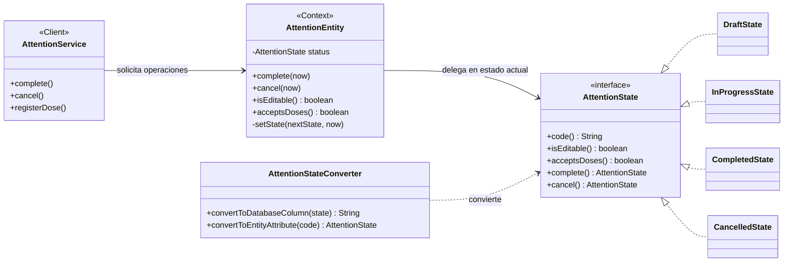
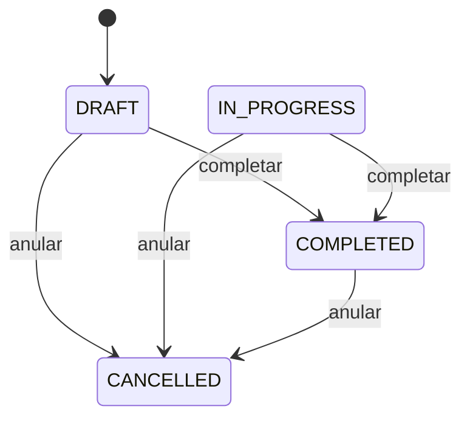

# Patrón de comportamiento: State en la atención clínica

## Intención y alcance

Una atención permite operaciones distintas según su estado. State encapsula
esas reglas en objetos de comportamiento y sustituye el enum `Status` de la
atención; no sustituye enums de otros dominios. No debe confundirse con Chain
of Responsibility: una operación se delega únicamente al estado actual, no
recorre una cadena de manejadores.

## Participantes y ubicación

| Rol | Componente | Responsabilidad |
|---|---|---|
| Cliente | `attentions/service/AttentionService` | Autoriza y orquesta transacciones, persistencia, auditoría e idempotencia. |
| Context | `attentions/entity/AttentionEntity` | Posee el estado actual, delega operaciones y asigna el siguiente estado mediante `setState` privado. |
| State | `attentions/state/AttentionState` | Define las capacidades y transiciones del ciclo de vida. |
| Concrete States | `DraftState`, `InProgressState`, `CompletedState`, `CancelledState` | Definen el comportamiento correspondiente a cada estado. Son inmutables y compartidos. |
| Adaptador | `attentions/entity/AttentionStateConverter` | Convierte entre los códigos persistidos y los estados; rechaza valores desconocidos o nulos. |

Las rutas anteriores son relativas a `services/api/src/main/java/com/pai/api/`.
El convertidor concentra la selección por código en la frontera de
persistencia; no existe un segundo enum de estados en el dominio.

## Diagrama de clases

## Transiciones y reglas

| Estado | Editar / registrar dosis | Completar | Anular |
|---|---|---|---|
| `DRAFT` | Sí | `COMPLETED` | `CANCELLED` |
| `IN_PROGRESS` | Sí | `COMPLETED` | `CANCELLED` |
| `COMPLETED` | No | Rechazada | `CANCELLED` |
| `CANCELLED` | No | Rechazada | Rechazada |

`IN_PROGRESS` se conserva para datos existentes; no se introduce una nueva
transición hacia él al registrar una dosis. El registro de dosis y la
anulación mantienen su semántica previa. El motivo de anulación se conserva
en el flujo de auditoría existente.

## Persistencia, contratos y límites

Los códigos `DRAFT`, `IN_PROGRESS`, `COMPLETED` y `CANCELLED` no cambian en la
base de datos ni en la respuesta HTTP. Las consultas reciben objetos State que
JPA convierte a los mismos códigos. No se requiere migración de datos.
El agregado impide cambios de detalles y ubicación en estados cerrados; un
intento de transición inválida no modifica el estado ni `updatedAt`. La
versión optimista, auditoría y repetición idempotente permanecen en sus capas
existentes.

## Principios y pruebas

El comportamiento específico está separado de la orquestación (SRP); los
clientes trabajan con el contrato `AttentionState` (DIP). Agregar un estado
requiere además actualizar el convertidor y revisar las transiciones y
contratos: State no elimina esos cambios. Las pruebas
`attentions/entity/AttentionStateTest` cubren la matriz de operaciones,
conversión, códigos inválidos y protección del agregado; las pruebas de
`AttentionServiceTest` ejercitan los flujos del servicio.
