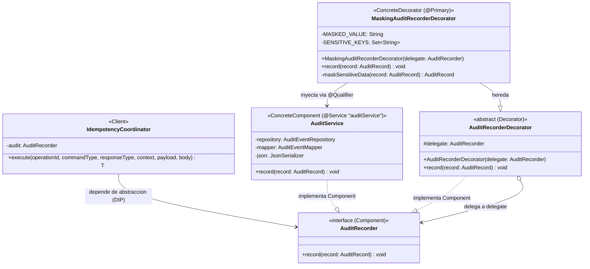

# Patron Estructural: Decorator (Decorador)

## 1. Intencion

Anadir responsabilidades adicionales a un objeto de forma dinamica sin modificar su estructura ni alterar las clases existentes. En este caso particular, se implementa el patron **Decorator** sobre el puerto de auditoria clinica (`AuditRecorder`).

El decorador intercepta el evento de auditoria emitido por operaciones de negocio (creacion de pacientes, atenciones, dosis), examina el `payload` JSON y **enmascara campos sensibles y credenciales** (`password`, `token`, `secret`, `accessToken`) antes de delegar la persistencia en el componente concreto (`AuditService`).

Esto asegura que el sistema cumpla con normativas de privacidad y seguridad de datos de salud (Habeas Data) sin acoplar la logica de persistencia JPA con la logica de sanitizacion (respetando el Principio Abierto/Cerrado - OCP y de Responsabilidad Unica - SRP).

---

## 2. Ubicacion en el Backend

- **`Component` (Interfaz comun):**  
  `services/api/src/main/java/com/pai/api/audit/service/AuditRecorder.java`
- **`ConcreteComponent` (Componente real de persistencia con `@Service("auditService")`):**  
  `services/api/src/main/java/com/pai/api/audit/service/AuditService.java`
- **`Decorator` (Decorador base abstracto):**  
  `services/api/src/main/java/com/pai/api/audit/service/AuditRecorderDecorator.java`
- **`ConcreteDecorator` (Decorador de enmascaramiento con `@Primary`):**  
  `services/api/src/main/java/com/pai/api/audit/service/MaskingAuditRecorderDecorator.java`
- **`Client` (Consumidor del puerto):**  
  `services/api/src/main/java/com/pai/api/shared/application/IdempotencyCoordinator.java`
- **Pruebas unitarias del Decorator:**  
  `services/api/src/test/java/com/pai/api/audit/service/MaskingAuditRecorderDecoratorTest.java`

---

## 3. Matriz de Roles del Patron (GoF)

| Rol GoF | Componente en TU-VACUNA-PAI | Responsabilidad |
| :--- | :--- | :--- |
| **`Component`** | `AuditRecorder` *(interface)* | Define el contrato abstracto para la grabacion de eventos de auditoria clinica. |
| **`ConcreteComponent`** | `AuditService` | Encargado unicamente de mapear y persistir el evento en PostgreSQL (`audit_events`). |
| **`Decorator`** | `AuditRecorderDecorator` *(abstract)* | Mantiene una referencia al objeto envuelto (`delegate`) e implementa `AuditRecorder`. |
| **`ConcreteDecorator`** | `MaskingAuditRecorderDecorator` | Intercepta `record()`, sanitiza llaves sensibles en mapas anidados y delega al siguiente eslabon. |
| **`Client`** | `IdempotencyCoordinator` | Depende exclusivamente de `AuditRecorder` e invoca la operacion de manera transparente. |

---

## 4. Codigo del ANTES (Sin Patron Decorator)

Antes de aplicar el patron, `AuditService` era la unica implementacion de `AuditRecorder`. El servicio persistia el payload tal como llegaba, sin posibilidad de aplicar transformaciones previas sin violar SRP y OCP.

### 4.1. `services/api/src/main/java/com/pai/api/audit/service/AuditService.java` (Antes)
```java
package com.pai.api.audit.service;

import com.pai.api.audit.AuditRecord;
import com.pai.api.audit.repository.AuditEventRepository;
import com.pai.api.shared.json.JsonSerializer;
import org.springframework.stereotype.Service;

@Service
public class AuditService implements AuditRecorder {

  private final AuditEventRepository repository;
  private final AuditEventMapper mapper;
  private final JsonSerializer json;

  public AuditService(
      AuditEventRepository repository, AuditEventMapper mapper, JsonSerializer json) {
    this.repository = repository;
    this.mapper = mapper;
    this.json = json;
  }

  @Override
  public void record(AuditRecord record) {
    // LIMITACION: Persistencia directa en base de datos sin sanitizacion.
    // Si el payload contiene contrasenas temporales o tokens, se guardan en texto plano en la BD.
    // Cualquier nueva responsabilidad transversal (logging, metricas, filtrado) exigia modificar esta clase.
    repository.save(mapper.toEntity(record, json.writeOrEmpty(record.payload())));
  }
}
```

---

## 5. Codigo del DESPUES (Con Patron Decorator)

### 5.1. Decorador Base: `AuditRecorderDecorator.java`
```java
package com.pai.api.audit.service;

import com.pai.api.audit.AuditRecord;

public abstract class AuditRecorderDecorator implements AuditRecorder {

  protected final AuditRecorder delegate;

  protected AuditRecorderDecorator(AuditRecorder delegate) {
    this.delegate = delegate;
  }

  @Override
  public void record(AuditRecord record) {
    delegate.record(record);
  }
}
```

### 5.2. Decorador Concreto: `MaskingAuditRecorderDecorator.java`
```java
package com.pai.api.audit.service;

import com.pai.api.audit.AuditRecord;
import java.util.Collections;
import java.util.LinkedHashMap;
import java.util.Map;
import java.util.Set;
import org.slf4j.Logger;
import org.slf4j.LoggerFactory;
import org.springframework.beans.factory.annotation.Qualifier;
import org.springframework.context.annotation.Primary;
import org.springframework.stereotype.Component;

@Component
@Primary
public class MaskingAuditRecorderDecorator extends AuditRecorderDecorator {

  private static final Logger log = LoggerFactory.getLogger(MaskingAuditRecorderDecorator.class);
  private static final String MASKED_VALUE = "******";
  private static final Set<String> SENSITIVE_KEYS = Set.of(
      "password", "contrasena", "token", "accesstoken",
      "access_token", "refreshtoken", "refresh_token", "secret", "authorization");

  public MaskingAuditRecorderDecorator(@Qualifier("auditService") AuditRecorder delegate) {
    super(delegate);
  }

  @Override
  public void record(AuditRecord record) {
    AuditRecord sanitized = maskSensitiveData(record);
    log.debug("Evento de auditoria procesado por MaskingAuditRecorderDecorator para {}", record.resourceType());
    delegate.record(sanitized);
  }

  private AuditRecord maskSensitiveData(AuditRecord record) {
    if (record == null || record.payload() == null) return record;

    if (record.payload() instanceof Map<?, ?> map) {
      Map<String, Object> sanitizedMap = new LinkedHashMap<>();
      for (Map.Entry<?, ?> entry : map.entrySet()) {
        String key = String.valueOf(entry.getKey());
        Object value = entry.getValue();
        if (isSensitiveKey(key)) {
          sanitizedMap.put(key, MASKED_VALUE);
        } else if (value instanceof Map<?, ?> nestedMap) {
          sanitizedMap.put(key, maskNestedMap(nestedMap));
        } else {
          sanitizedMap.put(key, value);
        }
      }
      return new AuditRecord(
          record.actorId(), record.institutionId(), record.action(),
          record.resourceType(), record.resourceId(), record.clientOperationId(),
          Collections.unmodifiableMap(sanitizedMap));
    }
    return record;
  }

  private Map<String, Object> maskNestedMap(Map<?, ?> map) {
    Map<String, Object> sanitized = new LinkedHashMap<>();
    for (Map.Entry<?, ?> entry : map.entrySet()) {
      String key = String.valueOf(entry.getKey());
      Object value = entry.getValue();
      if (isSensitiveKey(key)) sanitized.put(key, MASKED_VALUE);
      else if (value instanceof Map<?, ?> nested) sanitized.put(key, maskNestedMap(nested));
      else sanitized.put(key, value);
    }
    return sanitized;
  }

  private boolean isSensitiveKey(String key) {
    if (key == null) return false;
    String normalized = key.toLowerCase().replace("-", "").replace("_", "");
    return SENSITIVE_KEYS.contains(normalized);
  }
}
```

---

## 6. Diagrama de Clases UML (Mermaid)



---

## 7. Pruebas Unitarias del Decorator

Ubicadas en `services/api/src/test/java/com/pai/api/audit/service/MaskingAuditRecorderDecoratorTest.java`:
1. **Enmascaramiento de campos sensibles:** Verifica que claves como `password` y `accessToken` se sustituyan por `******`.
2. **Preservación de campos no sensibles:** Verifica que datos clínicos y correos válidos no se alteren.
3. **Manejo de estructuras anidadas:** Verifica que mapas embebidos dentro del payload se saniticen recursivamente.

Comando de ejecución:
```bash
./mvnw test -Dtest=MaskingAuditRecorderDecoratorTest
```
