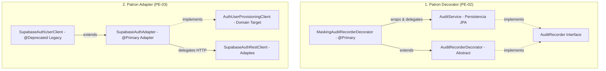

# Evaluacion de Cambios del Ultimo Merge: Patrones Estructurales (Decorator y Adapter)

## Goal Description
El ultimo merge en la rama `features-Jorman` ([commit fd9b35a](file:///C:/Users/jorma/Desktop/mi%20vacuna/tu_vacuna_pai)) integro los cambios del branch `master` provenientes del commit [01d4237](file:///C:/Users/jorma/Desktop/mi%20vacuna/tu_vacuna_pai) realizado por **Brayan** (`feat(patterns): incorporar patrones estructurales Decorator y Adapter con documentacion y tests`).

El objetivo de este documento es evaluar a profundidad qué implementó y evaluó el compañero de equipo, verificar la cobertura de sus pruebas unitarias, contrastar el diseño arquitectónico frente a los principios SOLID y GoF, e identificar recomendaciones o acciones a seguir.

---

## Que Evaluó e Implementó el Compañero

En este merge se incorporaron **11 archivos** (1,280 adiciones, 101 eliminaciones), centrados en **2 patrones estructurales de GoF** (con documentación que consolida 3 patrones junto con Proxy):



---

### Detalle de Componentes Evaluados

#### 1. Decorator: Enmascaramiento y Sanitización de Auditoría (`PE-02`)
* **Archivos clave:**
  * Componente abstracto: [`AuditRecorderDecorator.java`](file:///C:/Users/jorma/Desktop/mi%20vacuna/tu_vacuna_pai/services/api/src/main/java/com/pai/api/audit/service/AuditRecorderDecorator.java)
  * Decorador concreto: [`MaskingAuditRecorderDecorator.java`](file:///C:/Users/jorma/Desktop/mi%20vacuna/tu_vacuna_pai/services/api/src/main/java/com/pai/api/audit/service/MaskingAuditRecorderDecorator.java)
  * Componente real: [`AuditService.java`](file:///C:/Users/jorma/Desktop/mi%20vacuna/tu_vacuna_pai/services/api/src/main/java/com/pai/api/audit/service/AuditService.java#L16) (nombrado `@Service("auditService")`)
* **Qué evaluó:**
  * Sanitización de claves sensibles (`password`, `contrasena`, `token`, `accesstoken`, `access_token`, `refreshtoken`, `secret`, `authorization`) sustituyéndolas por `"******"`.
  * Sanitización recursiva en estructuras de mapa anidadas (`maskNestedMap`).
  * Tolerancia a `payload` nulo o no mapeado sin producir `NullPointerException`.
* **Pruebas evaluadas por el compañero ([`MaskingAuditRecorderDecoratorTest.java`](file:///C:/Users/jorma/Desktop/mi%20vacuna/tu_vacuna_pai/services/api/src/test/java/com/pai/api/audit/service/MaskingAuditRecorderDecoratorTest.java)):**
  1. `masksSensitiveKeysInPayload`: Valida enmascaramiento en el nivel raíz del mapa y conservación de campos normales.
  2. `masksNestedSensitiveKeys`: Valida el recorrido y enmascaramiento en mapas hijos anidados.
  3. `passesNullPayloadUnchanged`: Valida que registros con payload nulo pasan inalterados al delegado.

---

#### 2. Adapter: Aprovisionamiento de Identidad Supabase Auth (`PE-03`)
* **Archivos clave:**
  * Adaptee (Cliente HTTP técnico de bajo nivel): [`SupabaseAuthRestClient.java`](file:///C:/Users/jorma/Desktop/mi%20vacuna/tu_vacuna_pai/services/api/src/main/java/com/pai/api/identity/service/SupabaseAuthRestClient.java)
  * Adapter (Adaptador al dominio): [`SupabaseAuthAdapter.java`](file:///C:/Users/jorma/Desktop/mi%20vacuna/tu_vacuna_pai/services/api/src/main/java/com/pai/api/identity/service/SupabaseAuthAdapter.java)
  * Target de Dominio: [`AuthUserProvisioningClient.java`](file:///C:/Users/jorma/Desktop/mi%20vacuna/tu_vacuna_pai/services/api/src/main/java/com/pai/api/identity/service/AuthUserProvisioningClient.java)
  * Compatibilidad hacia atrás: [`SupabaseAuthUserClient.java`](file:///C:/Users/jorma/Desktop/mi%20vacuna/tu_vacuna_pai/services/api/src/main/java/com/pai/api/identity/service/SupabaseAuthUserClient.java) (anotado con `@Deprecated(forRemoval = true)`)
* **Qué evaluó:**
  * Desacoplamiento de la llamada HTTP (`RestClient`, headers Bearer, URLs de Edge Functions) respecto al contrato de negocio.
  * Mapeo del objeto de dominio `AuthUserProfile` a la estructura esperada por la Edge Function.
  * Traducción de fallos HTTP a excepciones de dominio:
    * HTTP `409 CONFLICT` $\rightarrow$ `EmailAlreadyExistsException`
    * HTTP `5xx` Server Error $\rightarrow$ `UncertainProvisioningException`
    * `ResourceAccessException` (Timeout / caída de red) $\rightarrow$ `UncertainProvisioningException`
    * Otros códigos HTTP no exitosos $\rightarrow$ `AuthUserProvisioningException`
  * Delegación limpia del borrado (`deleteAuthUser`).
* **Pruebas evaluadas por el compañero ([`SupabaseAuthAdapterTest.java`](file:///C:/Users/jorma/Desktop/mi%20vacuna/tu_vacuna_pai/services/api/src/test/java/com/pai/api/identity/service/SupabaseAuthAdapterTest.java)):**
  1. `createAuthUserSuccess`: Mapeo exitoso de campos y extracción del UUID retornado.
  2. `translatesConflictToEmailAlreadyExistsException`: Conversión de 409 a excepción de correo existente.
  3. `translates5xxToUncertainProvisioningException`: Conversión de error 500 a aprovisionamiento incierto.
  4. `translatesNetworkTimeoutToUncertainProvisioningException`: Conversión de timeout de red a aprovisionamiento incierto.
  5. `delegatesDeleteUser`: Verificación de llamada DELETE delegada al cliente REST.

---

#### 3. Documentación y Guías Académicas
El compañero incorporó además 3 archivos Markdown con propósitos de estudio y sustentación:
* [`docs/patterns-design/GUIA-PATRONES-ESTRUCTURALES.md`](file:///C:/Users/jorma/Desktop/mi%20vacuna/tu_vacuna_pai/docs/patterns-design/GUIA-PATRONES-ESTRUCTURALES.md): Guía unificada con guiones orales de 30 segundos, preguntas típicas de sustentación docente y diagrama UML Mermaid de los 3 patrones (Proxy + Decorator + Adapter).
* [`docs/patterns-design/adapter/README.md`](file:///C:/Users/jorma/Desktop/mi%20vacuna/tu_vacuna_pai/docs/patterns-design/adapter/README.md): Documento monográfico del Adapter con matrices GoF y diagramas de secuencia.
* [`docs/patterns-design/decorator/README.md`](file:///C:/Users/jorma/Desktop/mi%20vacuna/tu_vacuna_pai/docs/patterns-design/decorator/README.md): Documento monográfico del Decorator con comparativas Antes vs. Después.

---

## Hallazgos de la Evaluación Técnica

> [!NOTE]
> **Estado de la compilación y pruebas:**
> Se ejecutó la suite completa de pruebas unitarias y de arquitectura (`mvn test`).
> **Resultado:** 257 pruebas ejecutadas, **0 fallos, 0 errores, 0 omitidas**. Todas las reglas de ArchUnit (`ArchitectureTest`) se mantienen en verde.

### Puntos Fuertes (Aciertos de Diseño)
1. **Inyección Limpia en Spring:**
   * Uso de `@Primary` en `MaskingAuditRecorderDecorator` y `SupabaseAuthAdapter`, lo que permite que cualquier servicio que inyecte `AuditRecorder` o `AuthUserProvisioningClient` obtenga automáticamente la implementación mejorada sin tocar una sola línea de los consumidores.
   * Uso de `@Qualifier("auditService")` para inyectar explícitamente el `AuditService` de persistencia dentro del decorador.
2. **Respeto a OCP (Open/Closed Principle):**
   * Es posible añadir nuevos decoradores (por ejemplo `MetricsAuditRecorderDecorator` o `AsyncQueueAuditRecorderDecorator`) simplemente heredando de `AuditRecorderDecorator` y encadenándolos.
   * Es posible sustituir Supabase por otro proveedor de identidad (Auth0, Keycloak) creando un nuevo adaptador de `AuthUserProvisioningClient`.
3. **Mantenimiento de Compatibilidad:**
   * La clase antigua `SupabaseAuthUserClient` no fue borrada intempestivamente, sino que se convirtió en una subclase deprecada para evitar romper código heredado.

### Oportunidades de Mejora / Casos Borde Identificados
1. **Soporte de colecciones en el Decorador:**
   * `MaskingAuditRecorderDecorator` actualmente maneja mapas y mapas anidados (`instanceof Map<?, ?>`). Si un payload clínico contuviera una lista de elementos (por ejemplo `List<Map<String, Object>>`), la lista actual no se itera internamente para enmascaramiento.
2. **Excepciones en borrado (`deleteAuthUser`):**
   * En `SupabaseAuthAdapter.deleteAuthUser()`, la llamada a `restClient.deleteAuthUser()` no está rodeada de un bloque `try-catch` para capturar `HttpStatusCodeException` o `ResourceAccessException`. Si Supabase devuelve un 404 o timeout al borrar, la excepción viaja sin adaptar al dominio.

---

## User Review Required

> [!IMPORTANT]
> **Decisiones a revisar por el equipo:**
> 1. **¿Deseas implementar el manejo de excepciones en `deleteAuthUser`?** Podemos proteger la eliminación adaptando errores HTTP como se hizo en `createAuthUser`.
> 2. **¿Deseas extender el enmascarador de auditoría para listas anidadas (`List<Map<String, Object>>`)?**
> 3. **¿Deseas verificar si algún diagrama o documentación adicional necesita actualización en tu rama?**

---

## Open Questions

> [!NOTE]
> * ¿La revisión del merge es exclusivamente para fines de comprensión y sustentación académica, o necesitas que preparemos código adicional para complementar lo que hizo Brayan?

---

## Proposed Changes (Plan de Acciones Opcionales)

Si decides que complementemos la implementación de Brayan, este es el plan ordenado:

### 1. Robustecimiento de Adapter
#### [MODIFY] [`SupabaseAuthAdapter.java`](file:///C:/Users/jorma/Desktop/mi%20vacuna/tu_vacuna_pai/services/api/src/main/java/com/pai/api/identity/service/SupabaseAuthAdapter.java)
* Envolver `restClient.deleteAuthUser(accessToken, userId)` en bloque `try-catch` adaptando fallos de red o HTTP a `AuthUserProvisioningException`.
#### [MODIFY] [`SupabaseAuthAdapterTest.java`](file:///C:/Users/jorma/Desktop/mi%20vacuna/tu_vacuna_pai/services/api/src/test/java/com/pai/api/identity/service/SupabaseAuthAdapterTest.java)
* Agregar prueba unitaria para la captura de errores en `deleteAuthUser`.

### 2. Soporte de Listas en Decorator
#### [MODIFY] [`MaskingAuditRecorderDecorator.java`](file:///C:/Users/jorma/Desktop/mi%20vacuna/tu_vacuna_pai/services/api/src/main/java/com/pai/api/audit/service/MaskingAuditRecorderDecorator.java)
* Agregar método auxiliar `maskList(List<?> list)` para enmascarar listas que contengan mapas anidados con claves sensibles.
#### [MODIFY] [`MaskingAuditRecorderDecoratorTest.java`](file:///C:/Users/jorma/Desktop/mi%20vacuna/tu_vacuna_pai/services/api/src/test/java/com/pai/api/audit/service/MaskingAuditRecorderDecoratorTest.java)
* Agregar prueba unitaria con un payload que contenga una lista de mapas con credenciales.

---

## Verification Plan

### Automated Tests
* Ejecución de pruebas específicas de los patrones:
  ```powershell
  cd services/api
  .\mvnw.cmd test "-Dtest=MaskingAuditRecorderDecoratorTest,SupabaseAuthAdapterTest"
  ```
* Ejecución de suite completa de pruebas y reglas de arquitectura:
  ```powershell
  cd services/api
  .\mvnw.cmd test
  ```

### Manual Verification
* Revisar que los diagramas Mermaid en [`GUIA-PATRONES-ESTRUCTURALES.md`](file:///C:/Users/jorma/Desktop/mi%20vacuna/tu_vacuna_pai/docs/patterns-design/GUIA-PATRONES-ESTRUCTURALES.md) y [`README.md`](file:///C:/Users/jorma/Desktop/mi%20vacuna/tu_vacuna_pai/docs/patterns-design/adapter/README.md) coincidan exactamente con la estructura de clases del proyecto.
