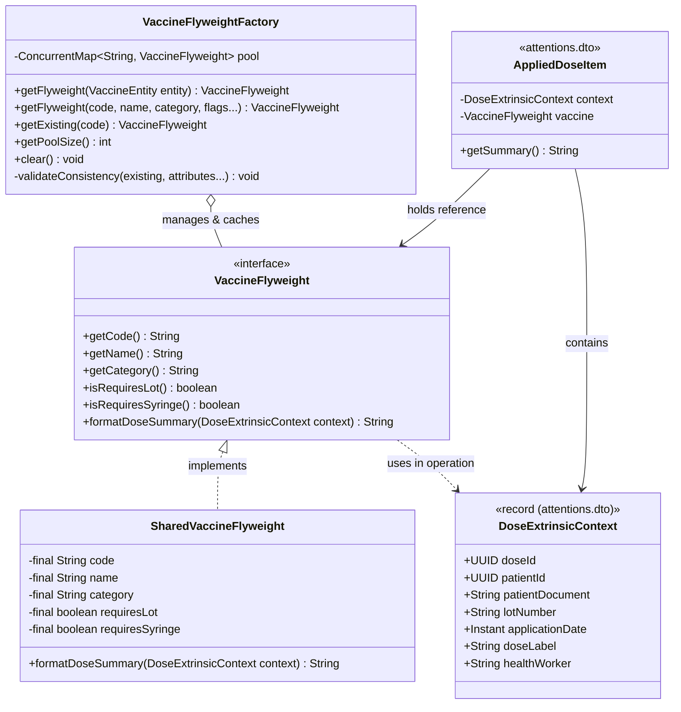
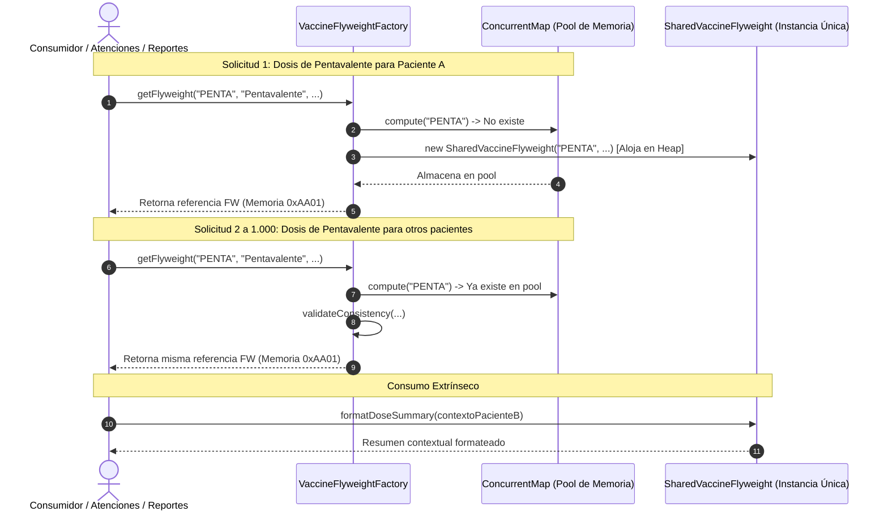

# Patron Estructural: Flyweight (Peso Ligero)

## 1. Intencion

El patron **Flyweight** permite mantener un gran numero de objetos de grano fino dentro de la memoria RAM disponible compartiendo las partes comunes del estado entre varios objetos en lugar de mantener toda la informacion en cada uno.

En **Tu Vacuna PAI**, este patron se aplica sobre la definicion y catalogacion de vacunas del Programa Ampliado de Inmunizaciones (`VaccineFlyweight` y `VaccineFlyweightFactory`) al procesar, consultar o exportar miles de dosis aplicadas (`AppliedDose`).

El patron se alinea formalmente con la arquitectura por capas ([ADR-006](file:///c:/Users/jorma/Desktop/mi%20vacuna/tu_vacuna_pai/docs/decisions/ADR-006-arquitectura-backend-por-capas.md)) y separa de manera estricta:
* **Estado Intrinseco (Compartido e Inmutable):** Codigo nacional PAI, nombre oficial del biologico, categoria clinica, y requerimientos tecnicos (lote, jeringa). Se mapea directamente desde la entidad JPA [`VaccineEntity`](file:///c:/Users/jorma/Desktop/mi%20vacuna/tu_vacuna_pai/services/api/src/main/java/com/pai/api/catalog/entity/VaccineEntity.java) y se aloja una sola vez en el pool de memoria administrado por la fabrica en `catalog.service`.
* **Estado Extrinseco (Contextual y No Compartido):** Datos clinicos particulares de cada aplicacion (identificador de la dosis, identificador del paciente, numero de lote del frasco, fecha/hora exacta y profesional vacunador), alojados en `attentions.dto`.

---

## 2. Ubicacion en la Arquitectura por Capas del Backend

Siguiendo la convencion del proyecto (sin paquetes artificiales por patron, igual que Proxy, Decorator y Adapter):

* **`Flyweight` (Interfaz del objeto compartido):**  
  [`services/api/src/main/java/com/pai/api/catalog/service/VaccineFlyweight.java`](file:///c:/Users/jorma/Desktop/mi%20vacuna/tu_vacuna_pai/services/api/src/main/java/com/pai/api/catalog/service/VaccineFlyweight.java)
* **`ConcreteFlyweight` (Implementacion con estado intrinseco inmutable):**  
  [`services/api/src/main/java/com/pai/api/catalog/service/SharedVaccineFlyweight.java`](file:///c:/Users/jorma/Desktop/mi%20vacuna/tu_vacuna_pai/services/api/src/main/java/com/pai/api/catalog/service/SharedVaccineFlyweight.java)
* **`FlyweightFactory` (Fabrica con pool thread-safe e integracion con `VaccineEntity`):**  
  [`services/api/src/main/java/com/pai/api/catalog/service/VaccineFlyweightFactory.java`](file:///c:/Users/jorma/Desktop/mi%20vacuna/tu_vacuna_pai/services/api/src/main/java/com/pai/api/catalog/service/VaccineFlyweightFactory.java)
* **`Excepcion de Consistencia` (Capa de excepciones de catalogo):**  
  [`services/api/src/main/java/com/pai/api/catalog/exception/InconsistentFlyweightException.java`](file:///c:/Users/jorma/Desktop/mi%20vacuna/tu_vacuna_pai/services/api/src/main/java/com/pai/api/catalog/exception/InconsistentFlyweightException.java)
* **`Extrinsic State` (Contexto particular de cada aplicacion clinica):**  
  [`services/api/src/main/java/com/pai/api/attentions/dto/DoseExtrinsicContext.java`](file:///c:/Users/jorma/Desktop/mi%20vacuna/tu_vacuna_pai/services/api/src/main/java/com/pai/api/attentions/dto/DoseExtrinsicContext.java)
* **`Client / Context Holder` (Asociacion entre dosis y flyweight compartido):**  
  [`services/api/src/main/java/com/pai/api/attentions/dto/AppliedDoseItem.java`](file:///c:/Users/jorma/Desktop/mi%20vacuna/tu_vacuna_pai/services/api/src/main/java/com/pai/api/attentions/dto/AppliedDoseItem.java)
* **Pruebas unitarias de concurrencia e inmutabilidad:**  
  [`services/api/src/test/java/com/pai/api/catalog/service/VaccineFlyweightTest.java`](file:///c:/Users/jorma/Desktop/mi%20vacuna/tu_vacuna_pai/services/api/src/test/java/com/pai/api/catalog/service/VaccineFlyweightTest.java)

---

## 3. Matriz de Roles del Patron (GoF)

| Rol GoF | Componente en TU-VACUNA-PAI | Responsabilidad |
| :--- | :--- | :--- |
| **`Flyweight`** | `VaccineFlyweight` *(interface)* | Declara la interfaz que permite al objeto compartir sus datos intrinsecos y operar recibiendo el estado extrinseco de una dosis. |
| **`ConcreteFlyweight`** | `SharedVaccineFlyweight` | Almacena los atributos inmutables (`final`) compartidos de la vacuna (codigo, nombre, categoria, banderas clinicas). No admite setters. |
| **`FlyweightFactory`** | `VaccineFlyweightFactory` | Administra el pool (`ConcurrentHashMap`), reutiliza instancias previas, valida consistencia y ofrece integracion directa con `VaccineEntity`. |
| **`Context`** | `DoseExtrinsicContext` + `AppliedDoseItem` | Mantiene los datos particulares no compartidos de cada dosis (paciente, fecha, lote) en la capa clinica (`attentions.dto`). |

---

## 4. Diagnostico del Problema (Sin Patron Flyweight)

En jornadas masivas de vacunacion PAI (por ejemplo, brigadas rurales o consultas historicas de un municipio):
* Se pueden procesar **miles de dosis aplicadas**.
* Si cada objeto de dosis replica en su propia estructura los nombres extensos de las vacunas (*"Vacuna Pentavalente (DTP-HB-Hib)"*), las descripciones de categoria y las reglas de administracion, la memoria heap se satura con copias identicas de strings redundantes.
* Esto genera alto consumo de RAM y sobrecarga recurrente en el Garbage Collector (GC) de la JVM.

### Comparativa: Con vs. Sin Flyweight

| Caracteristica | Sin Flyweight | Con Flyweight (PE-04) |
|---|---|---|
| **Instancias para 10.000 dosis de Pentavalente** | 10.000 objetos de definicion creados | **1 sola instancia** compartida en el pool |
| **Consumo de memoria Heap** | Duplicacion masiva de cadenas y estructuras | Huella en memoria fija $O(K)$, donde $K$ es el numero de tipos de vacunas |
| **Riesgo de corrupcion de datos** | Cada dosis puede tener datos inconsistentes de la vacuna | Estado intrinseco centralizado, inmutable y validado |
| **Operacion con contexto externo** | Strings concatenados por separado en cada capa | `formatDoseSummary(context)` centralizado y polimorfico |

---

## 5. Implementacion y Codigo del Patron

### 5.1. Inmutabilidad Estricta (`SharedVaccineFlyweight.java`)
Los atributos intrinsecos son estrictamente `final`. Ningun consumidor puede alterar el estado de una vacuna compartida:

```java
public final class SharedVaccineFlyweight implements VaccineFlyweight {

  private final String code;
  private final String name;
  private final String category;
  private final boolean requiresLot;
  private final boolean requiresSyringe;

  public SharedVaccineFlyweight(
      String code, String name, String category,
      boolean requiresLot, boolean requiresSyringe) {
    this.code = Objects.requireNonNull(code).trim().toUpperCase();
    this.name = Objects.requireNonNull(name).trim();
    this.category = (category == null || category.isBlank()) ? "BIOLOGICO_PAI" : category.trim();
    this.requiresLot = requiresLot;
    this.requiresSyringe = requiresSyringe;
  }
  // Solo getters. Sin setters. Inmutable y thread-safe.
}
```

### 5.2. Administracion Atomica, Consistencia e Integracion con `VaccineEntity`
La fabrica reutiliza las instancias en memoria mediante `pool.compute()` sobre un `ConcurrentHashMap`, asegurando que no se creen duplicados y evitando inconsistencias si un codigo ya registrado intenta sobreescribirse con atributos distintos:

```java
@Component
public class VaccineFlyweightFactory {

  private final ConcurrentMap<String, VaccineFlyweight> pool = new ConcurrentHashMap<>();

  // Integracion directa con la entidad JPA del catalogo
  public VaccineFlyweight getFlyweight(VaccineEntity entity) {
    Objects.requireNonNull(entity, "VaccineEntity no puede ser nula");
    return getFlyweight(
        entity.getCode(),
        entity.getName(),
        entity.getCategory(),
        entity.isHasLot(),
        entity.isHasSyringe());
  }

  public VaccineFlyweight getFlyweight(
      String code, String name, String category,
      boolean requiresLot, boolean requiresSyringe) {
    String normalizedCode = code.trim().toUpperCase();

    return pool.compute(normalizedCode, (key, existing) -> {
      if (existing == null) {
        return new SharedVaccineFlyweight(key, name, category, requiresLot, requiresSyringe);
      }
      validateConsistency(existing, name, category, requiresLot, requiresSyringe);
      return existing; // Retorna la referencia existente compartida
    });
  }
}
```

### 5.3. Interaccion con el Estado Extrinseco (`formatDoseSummary`)
El Flyweight no almacena al paciente ni al lote, pero puede operar con ellos cuando se los suministra como argumento:

```java
@Override
public String formatDoseSummary(DoseExtrinsicContext context) {
  return String.format(
      "[%s - %s] %s aplicada a paciente %s (Lote: %s, Fecha: %s, Aplicador: %s)",
      code, category, name,
      context.patientDocument(), context.lotNumber(),
      context.applicationDate(), context.healthWorker());
}
```

---

## 6. Diagrama de Clases UML (Mermaid)



---

## 7. Diagrama de Flujo de Memoria (Heap Allocation)



---

## 8. Guion Oral de Sustentacion (30 Segundos)

> *"Para optimizar el uso de memoria RAM cuando el sistema procesa miles de dosis aplicadas en reportes o jornadas masivas de vacunación, implementamos el patrón estructural **Flyweight**. Separamos la definición clínica de la vacuna —que es el estado intrínseco e inmutable mapeado desde `VaccineEntity` como código, nombre y requerimientos de biológico— de los datos de cada aplicación particular en `attentions.dto`, como el paciente, lote y fecha. La clase `VaccineFlyweightFactory` administra un pool concurrente thread-safe que reutiliza la misma instancia en memoria: si procesamos 10.000 aplicaciones de Pentavalente, en el heap de Java solo existe una única instancia compartida, reduciendo la presión sobre el Garbage Collector y garantizando total inmutabilidad."*

---

## 9. Preguntas Tipicas de Sustentacion Docente

### P1: ¿Cuál es la diferencia exacta entre el estado intrínseco y el extrínseco en su implementación?
* **Respuesta corta:** El intrínseco es compartido e independiente del contexto; el extrínseco es variable y depende de cada dosis particular.
* **Argumento técnico:** El intrínseco vive dentro de `SharedVaccineFlyweight` en `catalog.service` (código PAI, nombre oficial de la vacuna, categoría biológica y flags clínicos); es inmutable y no cambia sin importar qué paciente reciba la dosis. El extrínseco vive en `DoseExtrinsicContext` en `attentions.dto` (el ID del paciente, la fecha/hora de aplicación, el número de lote y el vacunador). El Flyweight recibe el estado extrínseco por parámetro en métodos como `formatDoseSummary()` sin guardarlo en sus atributos.

### P2: ¿Cómo garantizan que un hilo o una dosis no altere los datos de la vacuna que comparten las demás dosis?
* **Respuesta corta:** Mediante inmutabilidad estricta (`final`) y ausencia total de métodos mutadores.
* **Argumento técnico:** `SharedVaccineFlyweight` es una clase `final` cuyos campos son todos `private final`. No existen métodos `set`, y la fábrica utiliza `ConcurrentHashMap` para asegurar que la publicación de la referencia sea segura y libre de condiciones de carrera en entornos concurrentes de Spring Boot.

### P3: ¿Cómo se integra la fábrica Flyweight con la base de datos y entidades JPA del catálogo?
* **Respuesta corta:** Mediante el método sobrecargado `getFlyweight(VaccineEntity entity)`.
* **Argumento técnico:** `VaccineFlyweightFactory` forma parte de `com.pai.api.catalog.service` y puede recibir directamente instancias de `VaccineEntity`. Al cargar el catálogo de vacunas de PostgreSQL, la fábrica extrae los atributos inmutables y los cachea en el pool de memoria, permitiendo que cualquier reporte o servicio clínico obtenga el Flyweight sin duplicar memoria.

---

## 10. Verificacion y Pruebas Unitarias

Para ejecutar la suite de pruebas del patrón Flyweight y comprobar las reglas de arquitectura:

```powershell
cd services/api
.\mvnw.cmd test "-Dtest=VaccineFlyweightTest,ArchitectureTest"
```

Resultados obtenidos:
* **`returnsSameInstanceForRepeatedCalls`**: 1.000 solicitudes consecutivas retornan exactamente la misma referencia (`assertSame`) y el tamaño del pool permanece en 1.
* **`integratesDirectlyWithVaccineEntity`**: Comprueba que la fábrica genera y reutiliza la misma instancia compartida a partir de una entidad JPA `VaccineEntity`.
* **`supportsMultipleDistinctVaccinesInPool`**: Administra múltiples vacunas distintas en memoria compartiendo cada una individualmente.
* **`throwsExceptionOnInconsistentIntrinsicAttributes`**: Valida que inconsistencias de atributos sobre el mismo código lancen `InconsistentFlyweightException`.
* **`formatsSummaryWithExtrinsicStateWithoutMutatingFlyweight`**: Combina el estado intrínseco con distintos contextos extrínsecos sin alterar el objeto compartido.
* **`threadSafeConcurrentAccess`**: 16 hilos ejecutando 50 peticiones simultáneas obtienen exactamente la misma instancia sin condiciones de carrera.
