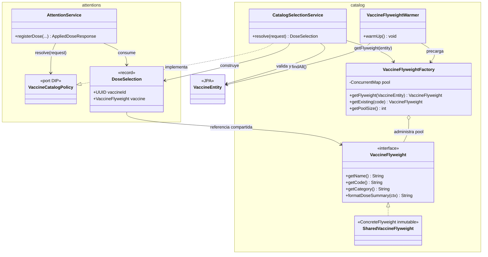
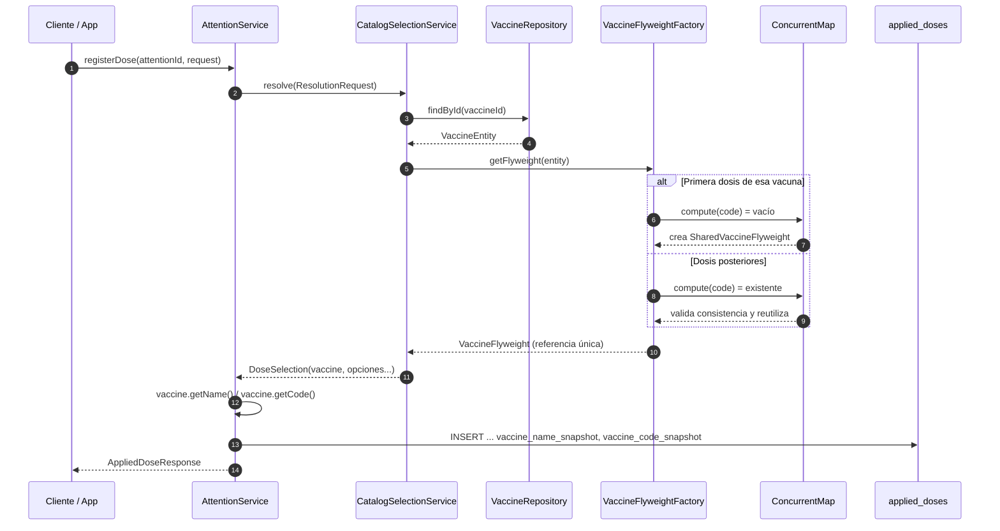

# Integración del Flyweight en el flujo real (PE-04)

> Documento **adicional**. No modifica la documentación entregada
> (`README.md` ni `GUIA-PATRONES-ESTRUCTURALES.md`); describe cómo el patrón
> pasó de estar implementado en aislamiento a ser consumido por el flujo de
> registro de dosis.

## 1. Qué cambió

| Archivo | Cambio |
|---|---|
| `attentions/service/VaccineCatalogPolicy.java` | `DoseSelection` ahora transporta `VaccineFlyweight` en lugar de `vaccineName`/`vaccineCode` |
| `catalog/service/CatalogSelectionService.java` | Inyecta `VaccineFlyweightFactory` y resuelve el flyweight desde `VaccineEntity` |
| `attentions/service/AttentionService.java` | `registerDose` toma nombre y código de la instancia compartida |
| `catalog/service/VaccineFlyweightWarmer.java` | **Nuevo.** Precarga el pool al iniciar la aplicación |
| `catalog/service/VaccineFlyweightIntegrationTest.java` | **Nuevo.** Pruebas de integración del pool |

Sin cambios en: esquema de base de datos, columnas `*_snapshot`, DTOs de la API,
endpoints ni en las pruebas del patrón aislado.

## 2. Diagrama de colaboración



## 3. Secuencia real de registro de una dosis



## 4. Snapshot vs. Flyweight (no compiten)

| | Snapshot (`*_snapshot`) | Flyweight (RAM) |
|---|---|---|
| Vive en | Columnas de `applied_doses` | Pool del JVM |
| Se escribe | Al registrar la dosis | Se precarga desde el catálogo |
| Propósito | Fidelidad histórica (append-only) | Evitar duplicar definiciones |
| Si el catálogo cambia | No cambia | Se recarga |
| Se usa para | Mostrar/exportar historial | Construir dosis y agregar |

El registro sigue guardando el snapshot: el Flyweight aporta la **referencia
compartida** con la que se obtienen nombre, código, categoría y banderas, no
reemplaza la evidencia histórica.

## 5. Verificación

```powershell
cd services/api
.\mvnw.cmd test
```

Resultado de esta integración:

* **266 pruebas ejecutadas**, 0 fallos, 0 errores, 0 omitidas.
* `VaccineFlyweightIntegrationTest`: 3 pruebas nuevas
  * dos resoluciones del catálogo comparten la misma instancia,
  * el warmer precarga una instancia por vacuna,
  * el warmer rechaza códigos duplicados inconsistentes.
* `ArchitectureTest`: 17 reglas en verde (el módulo clínico sigue sin depender
  de repositorios ni entidades del catálogo).

## 6. Alcance

Integrado en producción:

* `VaccineFlyweight`, `SharedVaccineFlyweight`, `VaccineFlyweightFactory`
  (registro de dosis y precarga del catálogo).

Soporte para resúmenes en memoria (usado por pruebas, disponible para reportes
futuros):

* `DoseExtrinsicContext`, `AppliedDoseItem`, `formatDoseSummary`.

Los reportes (`RegistroDiarioQueryService`, export XLS/CSV) siguen leyendo los
snapshots por diseño, para no alterar el historial clínico.
