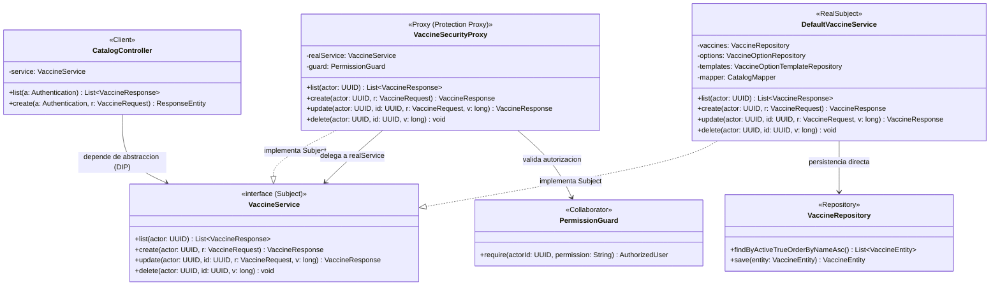
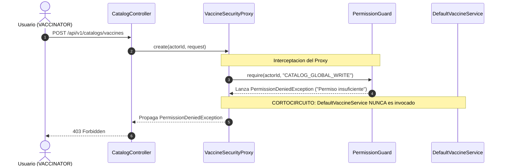

# Patron Estructural: Proxy (Protection Proxy)

## 1. Intencion

Proporcionar un sustituto o intermediario de otro objeto para controlar el acceso al mismo. En este caso particular, se implementa la variante **Protection Proxy (Proxy de Proteccion / Control de Acceso)** sobre el servicio del catalogo global de vacunas (`VaccineService`).

El Proxy intercepta todas las operaciones de consulta y modificacion del catalogo, verifica mediante `PermissionGuard` que el actor posea los permisos necesarios (`CATALOG_GLOBAL_READ` o `CATALOG_GLOBAL_WRITE`), y unicamente delega la invocacion en el Sujeto Real (`DefaultVaccineService`) si la autorizacion es valida. Si el actor no cuenta con el permiso requerido, la ejecucion se cortocircuita lanzando `PermissionDeniedException`, protegiendo la logica de negocio y la base de datos sin ejecutar consultas innecesarias.

---

## 2. Ubicacion en el Backend

- **`Subject` (Interfaz comun):**  
  `services/api/src/main/java/com/pai/api/catalog/service/VaccineService.java`
- **`RealSubject` (Sujeto Real):**  
  `services/api/src/main/java/com/pai/api/catalog/service/DefaultVaccineService.java`
- **`Proxy` (Protection Proxy con `@Primary`):**  
  `services/api/src/main/java/com/pai/api/catalog/service/VaccineSecurityProxy.java`
- **`Client` (Consumidor):**  
  `services/api/src/main/java/com/pai/api/catalog/controller/CatalogController.java`
- **`Collaborator` (Guardia de autorizacion):**  
  `services/api/src/main/java/com/pai/api/shared/security/PermissionGuard.java`
- **Pruebas unitarias del Proxy:**  
  `services/api/src/test/java/com/pai/api/catalog/VaccineSecurityProxyTest.java`

---

## 3. Matriz de Roles del Patron (GoF)

| Rol GoF | Componente en TU-VACUNA-PAI | Responsabilidad |
| :--- | :--- | :--- |
| **`Client`** | `CatalogController` | Controlador REST que expone los endpoints HTTP. Depende de la interfaz abstracta `VaccineService`. |
| **`Subject`** | `VaccineService` *(interface)* | Define el contrato publico comun para la gestion de vacunas, opciones y templates. |
| **`RealSubject`** | `DefaultVaccineService` | Contiene la logica de dominio pura, persistencia, versionamiento optimista y mapeo DTO. Desacoplado de la seguridad. |
| **`Proxy`** | `VaccineSecurityProxy` | Intercepta cada metodo, valida los permisos del actor (`CATALOG_GLOBAL_READ` / `WRITE`) y delega al Sujeto Real. |
| **`Collaborator`** | `PermissionGuard` | Resuelve el actor y lanza `PermissionDeniedException` si el actor carece del permiso solicitado. |

---

## 4. Codigo del ANTES (Sin Patron Proxy)

Antes de aplicar el patron, `VaccineService` era una **clase concreta** inyectada directamente en `CatalogController`. Dicha clase mezclaba la logica de negocio con verificaciones imperativas de seguridad en cada uno de sus metodos.

### 4.1. Cliente: `services/api/src/main/java/com/pai/api/catalog/controller/CatalogController.java` (Antes: Acoplado a clase concreta)
```java
@RestController
@RequestMapping("/api/v1/catalogs")
public class CatalogController {
  // Inyeccion directa de la clase concreta (Viola DIP)
  private final VaccineService service;
  private final EffectiveCatalogService effective;
  private final HealthInsurerService insurers;

  public CatalogController(
      VaccineService s, EffectiveCatalogService e, HealthInsurerService insurers) {
    service = s;
    effective = e;
    this.insurers = insurers;
  }
  ...
}
```

### 4.2. Clase Concreta Original: `services/api/src/main/java/com/pai/api/catalog/service/VaccineService.java` (Antes: Mezcla seguridad y persistencia)
```java
package com.pai.api.catalog.service;

import com.pai.api.catalog.dto.*;
import com.pai.api.catalog.entity.*;
import com.pai.api.catalog.exception.OptimisticCatalogException;
import com.pai.api.catalog.repository.*;
import com.pai.api.identity.service.AuthorizedUser;
import com.pai.api.shared.security.PermissionGuard;
import java.time.Instant;
import java.util.*;
import org.springframework.stereotype.Service;
import org.springframework.transaction.annotation.Transactional;

@Service
public class VaccineService {
  private final VaccineRepository vaccines;
  private final VaccineOptionRepository options;
  private final VaccineOptionTemplateRepository templates;
  private final PermissionGuard guard; // Acoplamiento a seguridad
  private final CatalogMapper mapper;

  public VaccineService(
      VaccineRepository v,
      VaccineOptionRepository o,
      VaccineOptionTemplateRepository t,
      PermissionGuard g,
      CatalogMapper m) {
    vaccines = v;
    options = o;
    templates = t;
    guard = g;
    mapper = m;
  }

  @Transactional(readOnly = true)
  public List<VaccineResponse> list(UUID actor) {
    // Mezcla de seguridad imperativa en metodo de dominio
    guard.require(actor, "CATALOG_GLOBAL_READ");
    return vaccines.findByActiveTrueOrderByNameAsc().stream()
        .map(mapper::toVaccine)
        .toList();
  }

  @Transactional
  public VaccineResponse create(UUID actor, VaccineRequest r) {
    // Mezcla de seguridad imperativa en metodo de dominio
    AuthorizedUser a = guard.require(actor, "CATALOG_GLOBAL_WRITE");
    VaccineEntity x = new VaccineEntity(
        UUID.randomUUID(),
        r.name(),
        r.code().trim(),
        r.category(),
        r.maxDoses(),
        r.minAgeMonths(),
        r.maxAgeMonths(),
        a.getId(),
        Instant.now());
    ...
    return mapper.toVaccine(vaccines.save(x));
  }

  @Transactional
  public VaccineResponse update(UUID actor, UUID id, VaccineRequest r, long version) {
    AuthorizedUser a = guard.require(actor, "CATALOG_GLOBAL_WRITE");
    VaccineEntity x =
        vaccines.findById(id).orElseThrow(() -> new IllegalArgumentException("Vacuna no existe."));
    if (x.getVersion() != version)
      throw new OptimisticCatalogException("La vacuna fue modificada por otro usuario.");
    x.update(
        r.name(), r.category(), r.maxDoses(), r.minAgeMonths(), r.maxAgeMonths(), true, a.getId());
    return mapper.toVaccine(vaccines.save(x));
  }

  @Transactional
  public void delete(UUID actor, UUID id, long version) {
    AuthorizedUser a = guard.require(actor, "CATALOG_GLOBAL_WRITE");
    VaccineEntity x =
        vaccines.findById(id).orElseThrow(() -> new IllegalArgumentException("Vacuna no existe."));
    if (x.getVersion() != version)
      throw new OptimisticCatalogException("La vacuna fue modificada por otro usuario.");
    x.update(x.getName(), x.getCategory(), x.getMaxDoses(), x.getMinAgeMonths(), x.getMaxAgeMonths(), false, a.getId());
  }

  @Transactional(readOnly = true)
  public List<OptionResponse> globalOptions(UUID actor, UUID vaccine) {
    guard.require(actor, "CATALOG_GLOBAL_READ");
    return options.findByVaccineIdAndActiveTrueOrderBySortOrderAscDisplayNameAsc(vaccine).stream()
        .map(mapper::toGlobalOption)
        .toList();
  }
  ...
}
```

---

## 5. Codigo del DESPUES (Con Patron Protection Proxy)

### 5.1. `Subject`: `services/api/src/main/java/com/pai/api/catalog/service/VaccineService.java`
Contrato abstracto que unifica tanto al Sujeto Real como al Proxy.

```java
package com.pai.api.catalog.service;

import com.pai.api.catalog.dto.OptionRequest;
import com.pai.api.catalog.dto.OptionResponse;
import com.pai.api.catalog.dto.VaccineRequest;
import com.pai.api.catalog.dto.VaccineResponse;
import java.util.List;
import java.util.UUID;

/**
 * Sujeto (Subject) del patron estructural Proxy para el catalogo global de vacunas.
 */
public interface VaccineService {

  List<VaccineResponse> list(UUID actor);

  VaccineResponse create(UUID actor, VaccineRequest r);

  VaccineResponse update(UUID actor, UUID id, VaccineRequest r, long version);

  void delete(UUID actor, UUID id, long version);

  List<OptionResponse> globalOptions(UUID actor, UUID vaccine);

  OptionResponse createOption(UUID actor, UUID vaccine, OptionRequest r);

  OptionResponse createTemplate(UUID actor, UUID vaccine, OptionRequest r);

  OptionResponse updateOption(UUID actor, UUID vaccine, UUID id, OptionRequest r);

  OptionResponse updateTemplate(UUID actor, UUID vaccine, UUID id, OptionRequest r);

  void deleteOption(UUID actor, UUID vaccine, UUID id, long version);

  void deleteTemplate(UUID actor, UUID vaccine, UUID id, long version);

  List<OptionResponse> templates(UUID actor, UUID vaccine);
}
```

### 5.2. `RealSubject`: `services/api/src/main/java/com/pai/api/catalog/service/DefaultVaccineService.java`
Implementacion de negocio pura. No inyecta `PermissionGuard` ni contiene verificaciones de seguridad.

```java
package com.pai.api.catalog.service;

import com.pai.api.catalog.dto.*;
import com.pai.api.catalog.entity.*;
import com.pai.api.catalog.exception.OptimisticCatalogException;
import com.pai.api.catalog.repository.*;
import java.time.Instant;
import java.util.*;
import org.springframework.stereotype.Service;
import org.springframework.transaction.annotation.Transactional;

/**
 * Sujeto Real (RealSubject) del patron estructural Proxy para el catalogo global de vacunas.
 */
@Service("defaultVaccineService")
public class DefaultVaccineService implements VaccineService {

  private final VaccineRepository vaccines;
  private final VaccineOptionRepository options;
  private final VaccineOptionTemplateRepository templates;
  private final CatalogMapper mapper;

  public DefaultVaccineService(
      VaccineRepository v,
      VaccineOptionRepository o,
      VaccineOptionTemplateRepository t,
      CatalogMapper m) {
    this.vaccines = v;
    this.options = o;
    this.templates = t;
    this.mapper = m;
  }

  @Override
  @Transactional(readOnly = true)
  public List<VaccineResponse> list(UUID actor) {
    return vaccines.findByActiveTrueOrderByNameAsc().stream()
        .map(mapper::toVaccine)
        .toList();
  }

  @Override
  @Transactional
  public VaccineResponse create(UUID actor, VaccineRequest r) {
    VaccineEntity x = new VaccineEntity(
        UUID.randomUUID(),
        r.name(),
        r.code().trim(),
        r.category(),
        r.maxDoses(),
        r.minAgeMonths(),
        r.maxAgeMonths(),
        actor,
        Instant.now());
    x.setLegacyFlags(
        r.hasLaboratory(), r.hasLot(), r.hasSyringe(), r.hasSyringeLot(),
        r.hasDiluent(), r.hasDropper(), r.hasPneumococcalType(),
        r.hasVialCount(), r.hasObservation());
    return mapper.toVaccine(vaccines.save(x));
  }

  @Override
  @Transactional
  public VaccineResponse update(UUID actor, UUID id, VaccineRequest r, long version) {
    VaccineEntity x =
        vaccines.findById(id).orElseThrow(() -> new IllegalArgumentException("Vacuna no existe."));
    if (x.getVersion() != version)
      throw new OptimisticCatalogException("La vacuna fue modificada por otro usuario.");
    x.update(
        r.name(), r.category(), r.maxDoses(), r.minAgeMonths(), r.maxAgeMonths(), true, actor);
    x.setLegacyFlags(
        r.hasLaboratory(), r.hasLot(), r.hasSyringe(), r.hasSyringeLot(),
        r.hasDiluent(), r.hasDropper(), r.hasPneumococcalType(),
        r.hasVialCount(), r.hasObservation());
    return mapper.toVaccine(vaccines.save(x));
  }

  @Override
  @Transactional
  public void delete(UUID actor, UUID id, long version) {
    VaccineEntity x =
        vaccines.findById(id).orElseThrow(() -> new IllegalArgumentException("Vacuna no existe."));
    if (x.getVersion() != version)
      throw new OptimisticCatalogException("La vacuna fue modificada por otro usuario.");
    x.update(
        x.getName(), x.getCategory(), x.getMaxDoses(), x.getMinAgeMonths(),
        x.getMaxAgeMonths(), false, actor);
  }

  @Override
  @Transactional(readOnly = true)
  public List<OptionResponse> globalOptions(UUID actor, UUID vaccine) {
    return options.findByVaccineIdAndActiveTrueOrderBySortOrderAscDisplayNameAsc(vaccine).stream()
        .map(mapper::toGlobalOption)
        .toList();
  }
  ...
}
```

### 5.3. `Proxy`: `services/api/src/main/java/com/pai/api/catalog/service/VaccineSecurityProxy.java`
Proxy de Proteccion anotado con `@Primary`. Intercepta las llamadas y valida las credenciales antes de delegar en `realService`.

```java
package com.pai.api.catalog.service;

import com.pai.api.catalog.dto.OptionRequest;
import com.pai.api.catalog.dto.OptionResponse;
import com.pai.api.catalog.dto.VaccineRequest;
import com.pai.api.catalog.dto.VaccineResponse;
import com.pai.api.shared.security.PermissionGuard;
import java.util.List;
import java.util.UUID;
import org.springframework.beans.factory.annotation.Qualifier;
import org.springframework.context.annotation.Primary;
import org.springframework.stereotype.Service;

/**
 * Proxy de Proteccion (Protection Proxy) para el catalogo global de vacunas.
 */
@Service
@Primary
public class VaccineSecurityProxy implements VaccineService {

  private final VaccineService realService;
  private final PermissionGuard guard;

  public VaccineSecurityProxy(
      @Qualifier("defaultVaccineService") VaccineService realService,
      PermissionGuard guard) {
    this.realService = realService;
    this.guard = guard;
  }

  @Override
  public List<VaccineResponse> list(UUID actor) {
    guard.require(actor, "CATALOG_GLOBAL_READ");
    return realService.list(actor);
  }

  @Override
  public VaccineResponse create(UUID actor, VaccineRequest r) {
    guard.require(actor, "CATALOG_GLOBAL_WRITE");
    return realService.create(actor, r);
  }

  @Override
  public VaccineResponse update(UUID actor, UUID id, VaccineRequest r, long version) {
    guard.require(actor, "CATALOG_GLOBAL_WRITE");
    return realService.update(actor, id, r, version);
  }

  @Override
  public void delete(UUID actor, UUID id, long version) {
    guard.require(actor, "CATALOG_GLOBAL_WRITE");
    realService.delete(actor, id, version);
  }

  @Override
  public List<OptionResponse> globalOptions(UUID actor, UUID vaccine) {
    guard.require(actor, "CATALOG_GLOBAL_READ");
    return realService.globalOptions(actor, vaccine);
  }

  @Override
  public OptionResponse createOption(UUID actor, UUID vaccine, OptionRequest r) {
    guard.require(actor, "CATALOG_GLOBAL_WRITE");
    return realService.createOption(actor, vaccine, r);
  }

  @Override
  public OptionResponse createTemplate(UUID actor, UUID vaccine, OptionRequest r) {
    guard.require(actor, "CATALOG_GLOBAL_WRITE");
    return realService.createTemplate(actor, vaccine, r);
  }

  @Override
  public OptionResponse updateOption(UUID actor, UUID vaccine, UUID id, OptionRequest r) {
    guard.require(actor, "CATALOG_GLOBAL_WRITE");
    return realService.updateOption(actor, vaccine, id, r);
  }

  @Override
  public OptionResponse updateTemplate(UUID actor, UUID vaccine, UUID id, OptionRequest r) {
    guard.require(actor, "CATALOG_GLOBAL_WRITE");
    return realService.updateTemplate(actor, vaccine, id, r);
  }

  @Override
  public void deleteOption(UUID actor, UUID vaccine, UUID id, long version) {
    guard.require(actor, "CATALOG_GLOBAL_WRITE");
    realService.deleteOption(actor, vaccine, id, version);
  }

  @Override
  public void deleteTemplate(UUID actor, UUID vaccine, UUID id, long version) {
    guard.require(actor, "CATALOG_GLOBAL_WRITE");
    realService.deleteTemplate(actor, vaccine, id, version);
  }

  @Override
  public List<OptionResponse> templates(UUID actor, UUID vaccine) {
    guard.require(actor, "CATALOG_GLOBAL_READ");
    return realService.templates(actor, vaccine);
  }
}
```

---

## 6. Diagramas del Patron (Archivos `.drawio`)

Los diagramas visuales completos estan disponibles en este mismo directorio:
- **`antes.drawio`:** Muestra el acoplamiento directo y la violacion de SRP/DIP previa.
- **`despues.drawio`:** Muestra la estructura canonica del patron Proxy con `Subject`, `RealSubject`, `Proxy` y `Client`.

### Diagrama de Clases (Mermaid)



### Diagrama de Secuencia: Cortocircuito de Seguridad



---

## 7. Pruebas Unitarias del Proxy: `services/api/src/test/java/com/pai/api/catalog/VaccineSecurityProxyTest.java`

En `VaccineSecurityProxyTest.java`, se comprueba el comportamiento del Proxy de forma aislada:
1. **Acceso Autorizado:** Verifica que con permisos validos, la llamada es delegada a `realService` y el resultado se propaga intacto.
2. **Acceso Denegado (Cortocircuito):** Verifica que si `PermissionGuard` lanza `PermissionDeniedException`, `realService` **nunca es invocado** (`verify(realService, never())...`).

Ejecucion de pruebas:
```bash
./mvnw test -Dtest=VaccineSecurityProxyTest
# Tests run: 5, Failures: 0, Errors: 0, Skipped: 0
```
